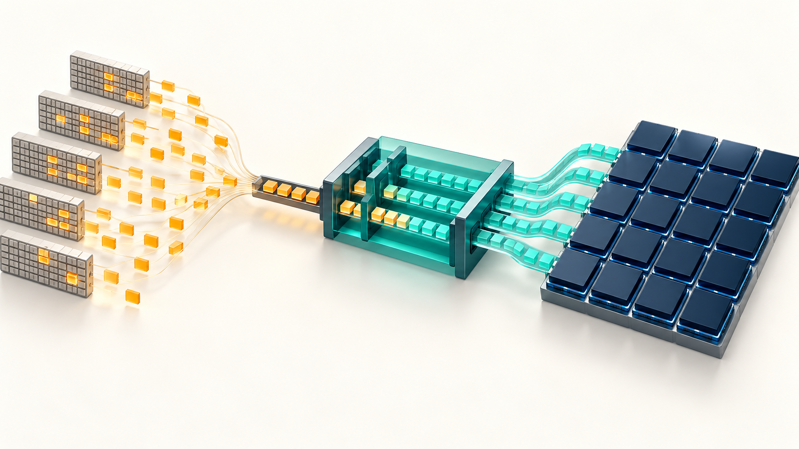
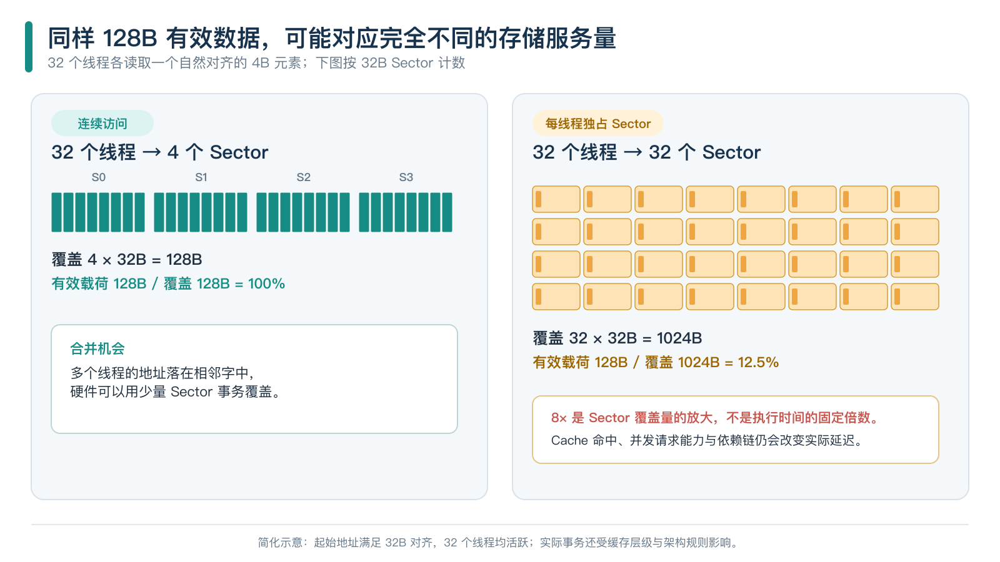
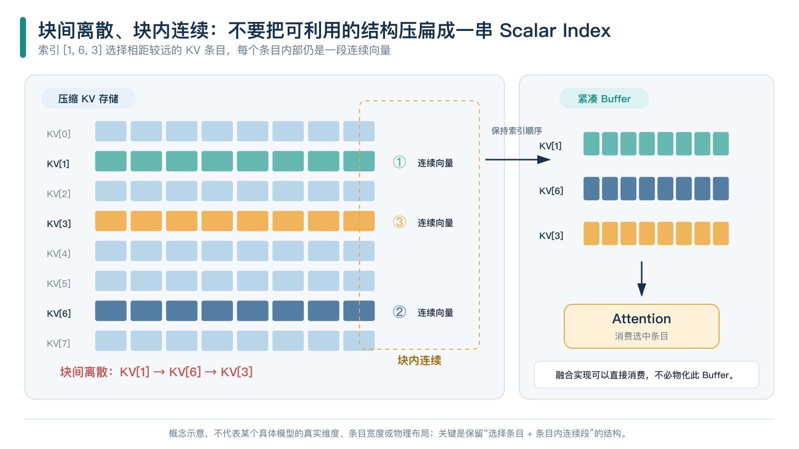

# 一条 Gather，为什么能把 NPU 拖慢？

## 从离散访存到乱序 TMA，重新理解数据搬运的成本

做算子性能优化时，常会碰到这样一种情况：算子没做多少计算，读取的有效数据也不多，运行时间却明显超出预期；沿着执行路径查下去，拖住流水线的往往是一条 Gather，或者一组需要通过索引才能确定地址的 Load。

从程序一侧看，Gather 只是按索引取回若干元素。CPU 有向量 Gather，GPU 可以让一个 Warp 中的线程分别访问不同地址，NPU 也有离散访存接口，读取几十个元素似乎不该成为难题。到了存储系统一侧，这几十个元素却可能对应几十次独立的地址查询，占用多个未完成请求项，并在沿途不断排队；即使数据已经位于片上 SRAM，只要集中到同一个 Bank 的请求超过它的服务能力，仍然要分批读取。

**一条指令能够表达多少次访存，与硬件每个周期能够服务多少个独立地址，是两笔不同的账。** 只看指令条数和有效字节数，不看地址分布、请求进入存储系统的方式以及结果返回消费者的路径，很容易高估 Gather 的执行效率，也容易把查询、调度或依赖造成的问题统称为“带宽不够”。



*开篇插画：离散请求经过数据搬运与组织后进入计算阵列。图片只表达文章主题，不对应某款芯片的实际版图或数据通路。*

许多 Gather 也没有表面上那么随机。它们可能在相隔较远的行之间选择数据，也可能在多个 KV Cache 条目之间跳转，但每一行、每个条目内部仍然连续。如果软件把这些结构全部展开成独立索引，硬件就得重新识别已经被抹去的规律；ND DMA、Tensor Memory Accelerator（TMA）以及本文讨论的乱序 TMA，都是在不同层次上保留和利用这些信息。

## 一、同样读取 128B，为什么存储系统的工作量会相差很大？

一个 NVIDIA GPU Warp 的 32 个线程各读取一个 FP32 元素，如果访问范围是从 `x[0]` 到 `x[31]`，并且满足相应的对齐要求，那么这 128B 数据在内存中连续分布，硬件可以把线程发出的访问合并为少量事务。即使打乱线程与元素之间的对应关系，只要访问的仍是这一组连续地址，需要覆盖的存储区域就不会扩大。

换成另一种模式：第 0 个线程访问 `x[0]`，第 1 个线程访问 `x[8]`，第 2 个线程访问 `x[16]`，后续线程按相同间隔读取。有效数据仍然只有 128B，每个线程却会落入不同的 32B Sector，存储系统触及的 Sector 总量远大于程序实际需要的字节数。

按照 NVIDIA CC ≥ 6.0 的 Global Memory Coalescing 模型，在 32 个线程均活跃、每个线程读取一个自然对齐的 4B 元素、起始位置满足 32B 对齐的条件下，可以得到下表；这里的 Stride 以元素为单位，“Sector 覆盖字节数”表示所触及 Sector 的大小之和，而不是从最小地址到最大地址的跨度，也不是已经测量到的 HBM 流量。[CUDA 合并访存说明][cuda]

| Warp 访问模式 | 触及的 32B Sector 数 | Sector 覆盖字节数 | 有效载荷比例 |
|---|---:|---:|---:|
| 连续访问，Stride = 1 | 4 | 128B | 100% |
| Stride = 2 | 8 | 256B | 50% |
| Stride = 4 | 16 | 512B | 25% |
| 每个线程落入不同 Sector，例如 Stride = 8 | 32 | 1024B | 12.5% |



*图 1：两种访问都只需要 128B 有效数据，触及的 Sector 数量却可以相差八倍。这里比较的是访问覆盖工作量，不能直接换算成耗时倍数。*

八倍的 Sector 差异不等于执行时间也增加八倍。Cache 命中、请求并发和跨指令复用可能吸收一部分成本；反过来，Tag 查询受限、Miss 跟踪资源耗尽，或者地址依赖造成串行等待，又会引入有效带宽解释不了的延迟。

Gather、Scatter 和 Atomic Scatter-Add 也不能混着分析。多个线程读取同一个地址时，硬件可能通过广播或请求合并减少工作量；多个线程更新同一地址时，除了访问本身，还要遵守相应的写入或原子更新语义。重复读取可能获得的收益不能直接套用到竞争写入上，普通离散读的带宽模型也解释不了全部原子冲突。

## 二、当带宽没有跑满时，瓶颈可能在请求发出去之前

一颗芯片的标称 HBM 带宽很高，Gather 的有效带宽却很低，第一反应通常是访存没有合并好。继续沿着请求进入 Cache 的路径检查，低带宽有时只是结果：系统没有足够快地查询、接纳和跟踪这些独立地址，自然也喂不满下游带宽；HBM 规格表写得再漂亮，也不会替尚未生成的请求占满总线。

假设一条 Gather 触及 32 条不同的 Cacheline，硬件要先判断这些地址是否命中 Cache。每个周期能够完成多少次独立 Tag 查询，取决于 Tag Array 的端口、Bank 划分和流水线组织，不会因为数据阵列有很高的字节带宽就自动增加。如果一批访问需要 `Q` 次查询，查询资源每周期最多接收 `p` 次，那么在不考虑其他冲突的理想情况下，仅让这些查询进入该资源，至少需要 `ceil(Q / p)` 个服务周期。

这个模型不假定某款芯片有多少个查询端口，只用来分清两类成本：访问从连续变为离散后，增加的既可能是搬运字节数，也可能是独立地址的查询与管理工作，而两者消耗的硬件资源并不相同。

Cache Miss 之后，请求还要占用 MSHR、Fill Buffer 或其他具有类似作用的跟踪结构，用来记录尚未完成的访问、接收返回数据并唤醒等待者。一条 Gather 同时产生大量独立 Miss 时，后续指令可能因为这些资源耗尽而停止发射；此时即使 DRAM 仍有剩余带宽，系统也没有更多可执行请求送过去。MICRO 2020 的 MDM 研究讨论了 Memory Divergence 引起的 L1 阻塞、NoC 排队和 DRAM 侧等待，其具体参数属于论文采用的平台与实验环境，但“请求资源先于带宽饱和”的关系仍然有助于理解离散访存。[MDM 论文][mdm]

地址依赖还会进一步压缩并发窗口。在 `value = x[index[i]]` 中，硬件必须先取得 `index[i]`，才能确定访问 `x` 的地址；如果索引也没有命中 Cache，数据请求只能等待索引返回。访问分散在许多 Page 上时，还可能叠加 TLB Miss 和 Page Walk 的成本。这类程序更像是在等待一条依赖链逐步推进，增加 HBM 带宽只能缓解其中实际传输数据的部分。

CPU 的向量 Gather 同样受这些条件约束。以 Arm Neoverse V2 的公开优化指南为例，在其给出的 128-bit SVE/SVE2、L1D 命中条件下，普通连续 LD1 的延迟和最高吞吐分别为 6 cycles、每周期 3 条，特定的 32-bit scaled-offset Gather 则为 10 cycles、每周期 0.5 条。这组数字反映特定微架构对两类指令的服务能力差异，不能直接推导为任意程序用了 Gather 都会慢六倍，因为缓存行为、依赖关系和实际指令形式都会改变结果。[Arm Neoverse V2 优化指南，Table 3-27][v2]

Spatter 对不同 CPU 平台和访问模式的测试也表明，向量化并不保证 Gather 总能获益。ISA 提供一条指令，只能说明这种操作可以被表达；要找出性能瓶颈，仍要把 Request、Sector、Wavefront、Cache Miss、未完成请求和依赖链放在一起看，不能停留在“已经用了向量指令”这一层。[Spatter 论文][spatter]、[Nsight Compute 指标说明][nsight]

## 三、把数据放进 SRAM，只是把问题推进到了 Bank

既然外存路径包含 Cache、地址翻译和 DRAM 等多层开销，一种直接的优化思路是先把数据搬入片上 SRAM，再通过 GPU Shared Memory、昇腾 UB 或其他软件管理的 Scratchpad 完成 Gather。这样可以减少重复外存访问及其不确定性，但离散地址一旦集中到少数 Bank，片上存储仍会排队。

假设 SRAM 分为多个 Bank，每个 Bank 每周期只能读取一个独立 Word，那么四个请求分散到四个 Bank 时有机会并行服务，访问同一 Bank 内四个不同 Word 时则必须分批完成。ISA 把四次访问封装成一条 Gather，不会改变这个服务下界。规格中的 1R1W 也只表示规定条件下的一次读和一次写，不能当作两个独立读端口使用。

对于一批读取，可以先在硬件明确允许的范围内合并重复地址，再统计 Bank `b` 实际需要服务的独立请求数 `n_b`。如果该 Bank 每周期最多提供 `r_b` 次相应服务，那么整批请求的理想服务时间至少满足下面的下界；Group 共享通路、读写混合和其他执行单元的竞争，只会增加限制。

```text
Cycles ≥ max_b ceil(n_b / r_b)
```


*图 2：左侧用单读口 Bank 解释服务周期，右侧用简化的 32-Bank、4B Word 模型说明 Padding 如何改变按列访问的映射。这些数字不代表昇腾 UB 的实际组织。*

讨论昇腾 UB 时，代际边界不能省略。公开的 2201 文档覆盖 Atlas A2/A3，描述了 192KB UB、48 个 Bank 和 16 个 Group；3510 文档所对应架构的 UB 为 256KB，包含 16 个 Bank、8 个 Group，并把每个 Bank 进一步划分为四个 8B Subbank。两套组织都叫“UB”，不代表它们适用同一套冲突规则。[2201 UB 说明][ub2201]、[3510 UB 说明][ub3510]

3510 文档说明 Subbank 在 Gather/Scatter 场景下被感知，并给出了同一 Subbank 中相同起始地址与不同起始地址的冲突规则。这些局部访问规则不能扩大为 GM 原子更新的广播保证，也不能把 Group 级允许的访问组合直接换算成每个物理 Bank 的独立端口数。LocalTensor Gather、GM 间接寻址和每个 Repeat 可处理的元素数，分别属于不同的数据路径或接口粒度，必须结合实际执行机制理解。

编译器的选择也会改变实际路径。Triton Ascend v3.6.0 的架构说明区分结构化与非结构化访存，并介绍了满足条件时采用 SIMT Indirect Load/Store 的相关路径。源程序里同样一次 Gather，最终可能对应局部重排、结构化搬运或全局间接读取，只有检查编译结果才能确定。[Triton Ascend 架构说明][triton]

## 四、软件可以改善 Bank 分布，但必须把转换成本一起算进去

访问具有明确规律时，软件常用 Padding 改变地址到 Bank 的映射。经典的 Shared Memory 矩阵转置案例把 `32×32` 的 Tile 扩展为 `32×33`，只增加 3.125% 的存储容量，就改变了按列读取时的 Bank 分布；在对应的简化模型下，原先相邻行跨过 32 个 Word，固定列的元素反复映射到同一个 Bank，行步长变为 33 个 Word 后，Bank 编号会随行号依次移动。[CUDA 矩阵转置与 Padding 说明][padding]

Padding 有效，是因为行步长与 Bank 数之间的关系可预测。面对完全随机的索引，它无法提供相同保证；Swizzle、XOR Hash 等布局变换也要结合消费者的访问模式设计，因为一种映射可能改善按列读取，却增加其他方向的地址计算或访问成本。布局优化要看整个生产者—消费者链路，不能只追求某个局部访问的均匀分布。

也可以改变请求发出的次序：先取得索引并识别目标 Bank，再把访问不同 Bank 的请求组合起来发出，返回后按原始索引恢复结果顺序。这种调度可以提高某些服务周期的 Bank 利用率，但要付出分桶、等待、请求 Tag 和结果重排的成本；如果所有请求都指向同一个单读口 Bank，重排也无法减少该 Bank 必须完成的独立读取次数。

对于重复读取的热点，还可以采用广播，或者把只读数据复制到多个 Bank，让调度器有更多选择。复制会占用片上容量，更新时还要维护副本；增加真正的 SRAM 读端口则会影响面积、功耗与时序。评估这类优化时，布局转换、索引预处理、额外 SRAM、调度缓冲和逆置换都要计入成本，只有后续访问能摊销这些额外工作，局部加速才可能变成端到端收益。

## 五、DeepSeek CSA 提醒我们，离散性可能只存在于条目之间

DeepSeek V4 的 Compressed Sparse Attention（CSA）是一个具体例子。根据公开 Model Card，CSA 沿序列维度压缩 KV，并结合稀疏注意力机制；TensorRT-LLM 的实现说明展示了对压缩条目评分、通过 Top-K 选择条目，再由融合 Attention 内核读取选中压缩 KV 的路径。[DeepSeek V4 Model Card][deepseek]、[TensorRT-LLM 实现说明][trt]

这条路径中存在 Gather，但离散性落在哪个维度，决定了合适的分析模型。当每个压缩条目的特征数据采用连续布局时，即使 Top-K 选中的条目在序列方向相距很远，条目内部的读取仍然连续；此时更接近“块间离散、块内连续”，而不是几十个线程各自随机读取一个 Scalar。连续段有多长、怎样物理排列，仍由具体 Kernel 的布局决定。



*图 3：索引选择顺序为 `[1, 6, 3]`，源端条目彼此离散，条目内部按连续向量示意。紧凑 Buffer 只是一种实现选择，融合内核也可以直接消费选中的数据；图中布局不是 DeepSeek 的固定存储契约。*

接口如果只向硬件提供一串 Scalar Index，硬件就要动态判断哪些地址可以合并；如果接口能直接表达“选择若干条目，并读取每个条目内部的一段连续数据”，搬运单元便可以围绕每个连续段规划请求，同时安排数据在片上 Buffer 中的布局。

Gather 也不一定要物化独立的中间 Tensor。先把选中的 KV 收集到紧凑 Buffer 再执行 Attention，通常更容易组织消费端访问；融合内核直接读取所需条目，则可能减少中间写回，但会增加寄存器、共享缓冲和调度压力。判断 CSA 的实际瓶颈时，应分别观察索引评分与 Top-K、压缩 KV 访问、条目搬运和 Attention 计算，不能因为其中一段 Gather 较慢，就断定整个 CSA 都受它限制。

这里的核心问题很具体：**算法中已有的连续性，能否一直保留到真正执行访存的接口，而不在逐元素展开时被提前丢掉？**

## 六、ND DMA 的价值，在于把地址规律直接交给搬运硬件

对于能用 Base、Length 和 Stride 描述的规则多维访问，如果搬运接口支持这种表达，软件就可以直接提交这些参数，让硬件按多维循环生成地址，省去展开全部索引、再由 Gather 单元识别地址关系的工作。以三维 Tensor 的仿射访问为例，只要各维长度和步长确定，后续地址就能通过计数器、增量和进位逻辑产生。

```text
addr(i0, i1, i2)
  = base
  + i0 * stride0
  + i1 * stride1
  + i2 * stride2

0 ≤ ik < lengthk
```

如果把 `i0` 定义为最内维，并且 `stride0` 等于元素宽度 `e`、`stride1 = length0 × e`，相邻行之间便没有地址空隙。硬件有机会把这些维度覆盖的区域看作更长的连续段，再按照 Burst 长度、对齐要求和 Page Boundary 拆成实际事务；与普通 Index Array 相比，这种描述保留了连续性及其边界，可以减少逐元素索引构造、索引传输和执行端重新识别规律的工作。

通用 Gather 也可以在动态窗口中做局部合并，但能看到多少规律，取决于索引到达的顺序和窗口容量。ND DMA 从接口中直接得到这些关系，地址生成、请求规划和数据搬运因而可以使用同一套结构；目的端如果支持相应的 Padding 或 Swizzle，还可以在搬入时安排消费者需要的片上布局，减少后续 Bank 冲突。

接口能表达什么，不等于具体实现已经做了什么。知道 Stride，并不能证明某个 DMA 已经支持跨行交织、Bank 感知调度或返回重排；这些能力仍要由队列、Tag、缓冲和足够的在飞请求容量支撑。地址即使完全可预测，集中到同一物理资源上的工作也绕不开该资源的服务下界。

ND Store 还要处理不同逻辑坐标映射到同一地址、源目的范围重叠，以及外部消费者何时能观察到写入等问题。完整的 ND DMA 接口除了表达地址规律，还要规定合法范围、别名与重叠行为、数据依赖和顺序约束，后续调度才能在提高并发的同时保持正确性。

## 七、GPU 已经能用 SIMT 搬数据，为什么还需要 TMA？

GPU 的 SIMT 执行模型本来就能完成多维地址计算，并由线程把数据从 Global Memory 搬到 Shared Memory。问题在于，如果一个 Kernel 不断重复相似的 Tensor 搬运，指令发射、地址计算和寄存器等资源就会长期承担这部分工作；矩阵计算吞吐越高，能否持续、低成本地提供下一块输入数据，对计算单元利用率的影响越直接。

Hopper 的 Tensor Memory Accelerator 将公开文档所描述的 1–5D Tensor 搬运交给专用机制，减少 SM 侧逐元素组织访问的工作，并避免相应搬运数据经由通用寄存器中转。结合异步完成机制和 Warp Specialization，负责数据准备的 Warp 可以与负责计算的 Warp 分工，让搬运和消费在满足依赖的前提下重叠。[Hopper Tuning Guide][hopper]

TMA 之前，GPU 已经可以绕过寄存器做异步复制，Ampere 的 `cp.async` 就提供了相应能力。TMA 增加的价值，是把多维描述、地址处理和较大粒度的搬运组织到更专用的接口中；它仍然要支付描述符准备、启动和同步成本，所以面对很小的数据块或大量动态 Scalar 索引，专用搬运未必比通用执行路径更划算。[CUDA 异步复制说明][async]

| 访问形态 | 更值得评估的执行路径 | 需要重点核算的成本 |
|---|---|---|
| 连续大块数据 | DMA / TMA | 启动、对齐、同步与实际搬运量 |
| 规则多维 Strided Tensor | ND DMA / TMA | 描述符准备、维度约束与事务拆分 |
| 离散条目，条目内部连续 | 受限 Tensor Gather、分组搬运或混合路径 | 条目选择、连续段大小与重排 |
| 任意 Scalar Index | SIMT / 通用 Gather | 索引依赖、地址分布与请求并发 |

这张表只给出评估方向，实际选择取决于目标硬件和完整执行成本。NVIDIA 的接口演进也在移动两类路径的边界：PTX 8.6 引入受限的 Tensor Gather4/Scatter4，用于特定二维 Tile 的四行搬运，使一部分“条目离散、条目内有结构”的访问可以使用专用机制；它们仍不是任意 Scalar Gather，也不能被泛化为所有 Blackwell 产品都具有相同的指令能力。[PTX Gather4/Scatter4 模式说明][gather4]

Gather4 的 `shared::cta` 形式和 `shared::cluster` 形式有不同的目标架构要求，后者涉及 `sm_100a` 及 PTX 8.8 增加的 `sm_100f` 支持，落到实现时仍要按具体指令形式核对目标限制。常规 TMA Tensor 搬运的 1–5D 范围，也不能作为更一般的六维 ND DMA 已经存在于产品中的证明。[PTX 指令与目标要求][ptx]

专用搬运有机会减少通用计算流水线花在地址生成和复制上的工作，但这些工作不会凭空消失，TMA 仍要取得参数并持续接收任务，配置路径的成本也就跟着进入了设计。

## 八、数据还没开始搬，描述符可能已经占用了大量工作

一项 ND DMA 往往需要 Base、多个维度的 Length 和 Stride，以及边界、Padding 或布局等信息。这些参数随每次搬运动态变化时，硬件必须在启动前取得它们。假设一套示意接口需要写入十五项配置，每项由一条指令完成，再用一条 Launch 启动，一次完整配置与启动就需要十六条指令；这些数字只用来说明接口成本，并非某款昇腾产品的实际规格。

一次搬运数百 KB 时，这些指令可能很容易摊销；如果每次只搬运几百 B，并且 Kernel 连续发起大量任务，参数准备就可能先于数据通路限制启动吞吐。可以把配置放入描述符并批量加载，也可以预先构造模板，只更新其中的动态字段。

减少指令条数，不等于减少参数信息量。把十五次写入压缩成一条批量配置指令，确实减少了软件显式发射的工作，但描述符字节仍要沿某条通路进入执行端；如果读取描述符又引入缓存查询、额外依赖或端口竞争，瓶颈只是从指令发射移到了配置数据传输。

参数复用能继续摊薄这笔成本。在上述示意接口中，如果十五项配置保持不变，并且语义允许连续执行 `R` 次 Launch，总指令数可以从 `16R` 降到 `15 + R`，均摊每次为 `1 + 15/R`。不过，真实算子中的 Base、Length 和边界常随动态 Shape、稀疏选择或控制流变化，设计时要分清哪些字段可以共享、哪些必须逐操作更新，以及如何低成本地组合二者。

如果 NPU 还希望让多项 TMA 同时在飞，并根据就绪状态决定发射顺序，“修改一套公共配置寄存器，再执行 Launch”的接口会遇到正确性问题：前一项操作尚未读取配置，后一项操作已经覆盖寄存器，那么前一项操作最终使用的参数就不再属于它。

## 九、乱序 TMA 的前提，是让参数跟随操作身份保持稳定

假设程序先配置并启动 TMA A，再配置并启动 TMA B。A 的源数据尚未准备好，B 的输入已经就绪，而且二者不存在禁止重排的内存依赖，让 B 先执行可以利用空闲的搬运资源。可如果 A 直到实际发射时才读取那套已经被 B 修改的公共配置寄存器，它就会误用 B 的 Base、Length 或 Stride。这里要先确定每项操作到底绑定了哪一份输入状态，性能要在正确性成立以后再谈。

对于本文讨论的 Superscalar NPU 设计，我认为一个必要要求是：**每项 TMA 在进入可乱序调度的状态时，都应当绑定语义上完整、确定的参数版本，不能在稍后的发射时刻重新读取一套含义已经改变的公共状态。** “确定”是指操作知道自己依赖哪一版参数，并不要求所有参数数值都已经计算完成；尚未就绪的动态字段仍可通过生产者标识或其他依赖机制等待，只要它们的版本归属不会被后续配置覆盖。

物理实现可以在适当阶段捕获参数快照，也可以让操作引用受生命周期保护的不可变 Descriptor 版本，还可以共享静态模板并单独绑定动态字段。每项操作不必机械地复制所有字段，但如果 Descriptor Pointer 指向的内容仍允许原地修改，硬件又没有定义捕获或版本保护机制，只保存指针仍然不能保证操作读到正确配置。


*图 4：A 绑定 V1 后等待输入；B 在无顺序冲突且数据就绪时先执行，A 随后仍使用 V1。时间线只表达依赖与版本关系，不代表实测周期或既有产品实现。*

参数依赖与数据依赖要分开跟踪，因为即使 A 的描述符已经完整，源 Buffer 仍可能正由上一条计算指令写入；参数就绪只说明硬件已经知道要搬哪些数据，能否读取还取决于数据依赖和内存顺序。能利用乱序机会的调度器要保留 A 的正确参数版本，同时分别检查输入数据、内存顺序和执行资源，让其他已经满足条件的任务继续推进。

为了避免配置覆盖，可以规定所有 TMA 都按程序顺序启动，并等上一项完成后再配置下一项；这样会简化状态管理，也会缩小计算与搬运、多项搬运之间的重叠机会。对追求 Superscalar 执行的 NPU，更有意义的问题是如何低成本地表达真实依赖，避免所有操作都受同一套可变配置状态牵制。

描述符、搬运与 Buffer 各有自己的生命周期，操作绑定 V1 后，系统还要知道何时可以修改或回收 V1 的存储位置，不能因为它们属于同一项 TMA 就共用一个粗粒度的完成时刻。如果 A 尚未读完参数，V1 就被复用，即使操作保存了正确的版本标识，也可能读到错误内容；反过来，如果全部参数已经安全捕获，描述符存储可能在数据搬运结束前就满足回收条件，所以描述符生命周期不能与数据传输生命周期强行合并。

参数绑定、描述符的末次读取、搬运完成、写入对消费者可见，以及 Buffer 可以安全复用，可能分别发生在不同的时刻。具体实现必须通过完成通知和内存语义定义这些边界；处理器如果还支持异常、中断或上下文切换，在飞操作的状态如何保留、排空或恢复，也要进入架构契约，不能留给软件猜测。

乱序带来的收益最终要覆盖控制结构的成本，因为参数快照、版本表、依赖跟踪、任务队列和返回重组缓冲都会消耗面积、功耗与时序预算，只看数据通路比以前忙了多少，还不足以判断这套设计是否划算。评价乱序 TMA 时，除了看它隐藏了多少等待，还要测量参数构造与绑定的吞吐、允许在飞的独立版本数、实际启动间隔，以及执行端等待完成期间能否继续接收后续任务；只有这些环节共同提供足够并发，数据通路才可能获益。

NVIDIA 的异步 TMA 已经展示了专用搬运与计算重叠的价值，但异步提交不等于本文讨论的多操作独立就绪判断和乱序调度。本文提出的是让每项 TMA 都具有明确的输入版本、数据依赖、内存约束和执行生命周期，使其能够作为完整的架构操作参与 NPU 调度。它能节省多少周期、增加多少并发，是否值得付出相应的 PPA 成本，仍然要靠实现和测量回答。

## 十、Gather 优化，最终要回到整条执行时间线

“读取若干元素”是一个紧凑的软件表达，执行它却要经历索引准备、地址生成、请求查询、事务传输、片上落地、结果归位和计算消费。地址分布或依赖关系的变化，可能让其中任何一环成为最终完成时间的决定因素，这也是一条 Gather 能拖慢整个算子的原因。

如果算法已经知道选中的是若干连续条目，编译器却只能把它们展开成 Scalar Index，那么硬件需要花资源重新找出这些关系；如果 ISA 保留了条目和维度信息，编译器与 Runtime 又要按各自分工处理描述符、启动和同步，搬运端则承担地址生成；若进一步支持乱序执行，还需要由调度与搬运机制分工处理依赖和必要的返回重组。结构信息从软件一路传到硬件，才有机会减少重复劳动，但接口增加一种能力，也意味着有人要实现、维护并支付它的成本。

这些层次彼此牵连。Padding 可以改善 Bank 映射，却不能消除索引依赖；ND DMA 可以减少地址生成工作，却不能突破物理 Bank 的服务上限；TMA 可以释放通用执行资源，但仍要支付配置与同步成本；乱序调度可以利用独立任务隐藏等待，也要为在飞状态和依赖管理付出代价。局部优化只有放回端到端时间线，才能判断它缩短了关键路径，还是把工作移到了别处。

分析具体算子时，可以先识别访问结构和真实执行路径，再测量索引准备、请求服务、搬运与同步分别占用的时间，并比较优化前后的完整 Kernel 延迟、有效数据吞吐和额外存储开销。如果软件预处理需要重复执行，或者布局转换无法被后续访问复用，这些成本也要计入比较，不能只保留最有利的搬运阶段。

回到开头那条拖慢算子的 Gather，我更关心的设计判断是：能否用少量地址与调度控制，让已有的计算单元和存储资源少等一些时间，又不让新增的端口、队列和重排缓冲吃掉收益。计算吞吐越高，及时供数越重要，但更大的控制窗口也要落到面积、功耗和时序上；只有把这两边的账算到同一个算子、同一颗芯片上，才能判断乱序 TMA 是值得付出的复杂度，还是又一次把瓶颈搬了家。

---

## 参考资料

以下资料用于说明对应产品或研究的公开行为，文中的服务下界、示意接口和乱序 TMA 方案则属于明确给定假设下的分析或设计讨论；在线资料核对日期为 2026 年 10 月 29 日，不同文档的架构与版本范围应分别理解。

1. [NVIDIA CUDA C++ Best Practices Guide：Global Memory Coalescing][cuda]；[Shared Memory 与 Padding][padding]。
2. [MDM: The GPU Memory Divergence Model，MICRO 2020][mdm]。
3. [Arm Neoverse V2 Software Optimization Guide，r0p2 / Issue 3.0][v2]。
4. [Spatter: A Tool for Evaluating Gather / Scatter Performance][spatter]。
5. [NVIDIA Nsight Compute Profiling Guide：Quantities][nsight]。
6. [Ascend 2201：避免 UB Bank 冲突][ub2201]；[Ascend 3510：避免 UB Bank 冲突][ub3510]。
7. [Triton Ascend v3.6.0：架构设计与核心特性][triton]。
8. [DeepSeek V4 Model Card][deepseek]。
9. [TensorRT-LLM：DeepSeek V4 on NVIDIA Blackwell][trt]。
10. [NVIDIA Hopper Tuning Guide：Tensor Memory Accelerator][hopper]。
11. [CUDA Programming Guide 13.2.1：Asynchronous Data Copies][async]。
12. [PTX ISA：cp.async.bulk.tensor][ptx]；[Tile Scatter4 and Tile Gather4 Modes][gather4]。

[cuda]: https://docs.nvidia.com/cuda/cuda-c-best-practices-guide/index.html#coalesced-access-to-global-memory
[padding]: https://docs.nvidia.com/cuda/cuda-c-best-practices-guide/index.html#shared-memory-in-matrix-multiplication-c-aat
[mdm]: https://microarch.org/micro53/papers/738300b009.pdf
[v2]: https://documentation-service.arm.com/static/668bc0a369e89f01e39c4668
[spatter]: https://arxiv.org/html/1811.03743v5
[nsight]: https://docs.nvidia.com/nsight-compute/ProfilingGuide/index.html#quantities
[ub2201]: https://asc.gitcode.com/guide/operator_practice/simd_operator_optimization/memory_access/avoid_ub_bank_conflict/avoid_bank_conflict_npu_arch_2201.html
[ub3510]: https://asc.gitcode.com/guide/operator_practice/simd_operator_optimization/memory_access/avoid_ub_bank_conflict/avoid_bank_conflict_npu_arch_3510.html
[triton]: https://triton-ascend.readthedocs.io/zh-cn/v3.6.0/architecture_design_and_core_features.html
[deepseek]: https://fe-static.deepseek.com/chat/transparency/deepseek-V4-model-card-EN.pdf
[trt]: https://nvidia.github.io/TensorRT-LLM/blogs/tech_blog/blog26_DeepSeek_V4_on_NVIDIA_Blackwell_Model_Specific_and_Agentic_Workload_Optimizations_in_TensorRT-LLM.html
[hopper]: https://docs.nvidia.com/cuda/hopper-tuning-guide/index.html#tensor-memory-accelerator
[async]: https://docs.nvidia.com/cuda/archive/13.2.1/cuda-programming-guide/04-special-topics/async-copies.html
[ptx]: https://docs.nvidia.com/cuda/parallel-thread-execution/index.html#data-movement-and-conversion-instructions-cp-async-bulk-tensor
[gather4]: https://docs.nvidia.com/cuda/parallel-thread-execution/index.html#tile-scatter4-and-tile-gather4-modes
