# 任务超标量：一种乱序执行的任务流水线

**Task Superscalar: An Out-of-Order Task Pipeline**

Yoav Etsion、Felipe Cabarcas、Alejandro Rico、Alex Ramirez、Rosa M. Badia、Eduard Ayguadé、Jesús Labarta、Mateo Valero

*发表于 2010 年第 43 届 IEEE/ACM 国际微体系结构研讨会（MICRO 43），原文第 89—100 页，DOI：10.1109/MICRO.2010.13。本文为中文全译，保留原文论述顺序、数据、术语缩写和图表编号；文末参考文献保留原始书目信息。*

## 摘要

本文提出**任务超标量（Task Superscalar）**：将指令级乱序流水线的思想提升到任务粒度的一种体系结构抽象。传统的指令级并行（ILP）流水线能够从顺序指令流中发掘并行性；与之类似，任务超标量能够从单个顺序线程生成的任务中挖掘任务级并行性。程序员只需直观地标注任务的输入和输出，任务超标量流水线便可动态识别任务间的数据依赖、找出可并行执行的任务，并以乱序方式执行。

我们进一步提出一种**分布式任务超标量流水线前端**，可以嵌入各种众核架构，并像管理功能单元一样管理处理器核心。

实验表明，该机制可以同时驱动数百个处理器核心执行无需推测的任务，使流水线能够维持包含数万项任务的执行窗口。借助 7 MB 片上 eDRAM，它能够将任务的平均译码间隔控制在 60 ns 以下，并动态识别多达约 50,000 个在途任务之间的数据依赖。在模拟的 256 核 CMP 上，对九项科学计算基准程序的测试取得了相对于顺序执行 **95～255 倍、平均 183 倍**的加速。

因此，任务超标量既能帮助程序员有效利用众核系统，也能大幅简化其编程模型。

**关键词：**乱序执行；CMP/众核；任务超标量；并行编程。

## 一、引言

随着芯片内并行成为处理器发展的主要方向，研究者开始积极探索更易使用的并行编程模型。近年来，Cilk [3]、OpenMP 3.0、Intel TBB、CUDA 和 OpenCL 等任务式编程模型日益流行，说明“任务”是一种符合程序员直觉的编程抽象。

但常见任务模型有一个突出缺点：它们将识别和处理任务间数据依赖这一并不简单的工作交给了程序员。此外，许多任务模型依赖全部或部分任务的屏障同步，因此难以利用相距较远的任务之间存在的并行机会。图 1 展示了这两个问题：即便只是对一个 5×5 矩阵进行 Cholesky 分解，其依赖图也相当不规则，而且包含远距离并行性。例如，在总共 35 个任务中，按生成顺序编号的第 6 个和第 23 个任务实际上可以并行执行。

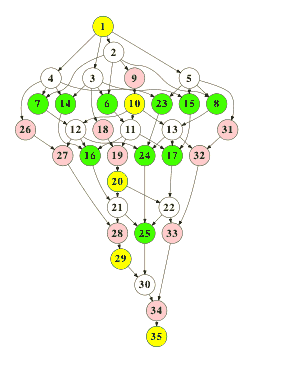

**图 1｜5×5 Cholesky 分解的任务依赖图。**数字表示任务创建顺序，不同深浅的节点代表不同的计算内核。

近年来出现的一类基于任务的数据流编程模型，可以自动解析数据依赖关系。程序员在内核函数的输入、输出操作数上添加标注，运行时系统便能动态构建任务间数据依赖图，进而提取任务级并行性。这类模型包括 Jade [20]、StarSs [2,17]、Intel RapidMind [14]、OoOJava [10] 和 Sequoia [7]。不过，它们依赖软件进行依赖分析，速度天然受限，阻碍了系统规模的扩展 [19]。

与此形成对照的是，传统乱序流水线非常擅长快速识别指令间的数据依赖。如果将乱序流水线扩展到任务粒度，就有机会高效利用大规模众核硬件，并显著降低编程难度。

为此，本文提出**任务超标量多处理器**：一种在任务粒度上工作的动态调度乱序处理器，将各个核心视作执行任务的功能单元。借助任务式数据流编程接口，处理器能够识别任务间依赖、构建数据依赖图，再调度任务执行。程序员看到的依然是顺序的编程接口，底层硬件却能够并行执行——这正是传统乱序处理器最有吸引力的特性。

为了验证这一思路，本文还设计了一种分布式任务超标量前端。它可以集成到几乎任何众核架构中，将整个硬件组织为一台任务超标量多处理器。我们将证明，这一设计提供的依赖译码速度足以驱动大型众核系统执行粒度相对较细的任务。

图 2 展示了系统的总体流程。任务生成线程将任务送入流水线前端，由前端解析数据依赖。由于任务生成线程与任务本身的执行相互解耦，任务间的控制流已经由生成线程确定，因此进入流水线的任务**不需要推测执行**。前端维护一个由近期生成任务组成的窗口，在窗口内构建数据依赖图、发现任务级并行性。正因为任务无需推测，这个窗口能够扩展到数万项任务，发掘大量潜在并行机会 [6]。

此外，流水线还可以通过**内存对象重命名**来消除反依赖和输出依赖，进一步扩大可用并行度。准备就绪的任务被送至执行后端；后端由任务调度器、排队系统和众核计算资源组成，同时仍能作为普通的片上多处理器（CMP）运行。

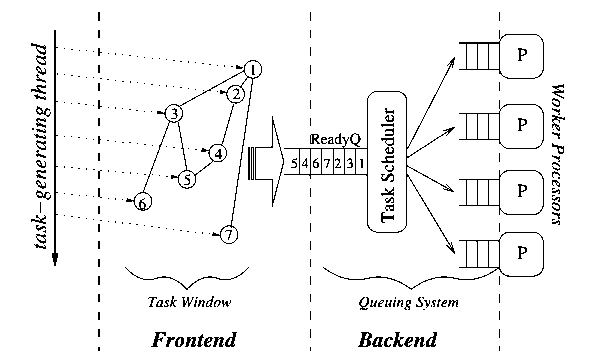

**图 2｜任务超标量系统的总体结构。**任务生成线程向前端提交任务，前端在任务窗口中完成依赖解析；就绪任务经由后端的调度和排队系统交给工作处理器执行。

由于天然支持任务式数据流执行，任务超标量也便于承载 MapReduce、Intel Ct [8] 和 Intel CnC [12] 等高层编程范式。

我们从多个方面评估这条流水线：分布式架构的扩展能力及其对数据依赖译码速率的影响；任务窗口大小能够揭示多少并行性，以及最终能够带来多少加速；与经过充分优化的 StarSs 软件依赖译码器相比，硬件机制在可扩展性上有何差异。实验采用表 1 所列的九项科学计算应用及内核，它们均使用 StarSs 编程模型进行了并行化。

后文安排如下：第二节说明快速依赖译码为何是任务式数据流模型扩展的关键；第三节讨论如何将 ILP 技术用于任务，并介绍 StarSs 编程模型；第四节给出任务超标量前端的具体设计；第五节介绍实验方法；第六节评估实验结果；第七节回顾相关工作；第八节总结全文。

*注 1：本文所称“任务”，是指调用经过特殊标注的内核函数时创建的一个动态实例；更一般地，它也可以是独立代码块 [10]。*

## 二、研究动机：必须足够快地解析任务依赖

一个任务创建之后，系统需要识别它与其他任务之间的数据依赖，才能将其加入任务图。我们把这个过程称为**任务译码（task decode）**。要充分利用 CMP，任务加入依赖图的速度就必须快于处理单元消耗任务的速度。因此，高速任务译码是大规模 CMP 得到充分利用的必要条件。

图 3 用一个理想调度过程说明了两者之间的关系：假设每个任务执行时间为 $T$，系统有 $P=4$ 个处理器。为了保持较高利用率，系统必须每隔 $T$ 个时间单位发出 $P$ 个任务，也就是平均每隔

$$R=\frac{T}{P}$$

发出一个任务。这也给出了任务译码间隔应达到的目标。随着处理器数目 $P$ 增加，要么进一步提高译码吞吐率，要么通过编写执行时间更长的任务，降低处理器消耗任务的速度。

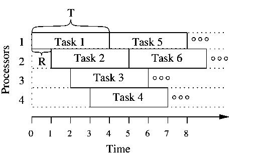

**图 3｜维持处理器充分利用时所允许的最大平均译码间隔。**若单个任务耗时为 $T$，共有 $P$ 个处理器，则任务译码间隔 $R$ 不应超过 $T/P$。

但简单地延长任务执行时间，会让整个系统更容易受到内存访问的限制。对于同一段代码，执行时间通常取决于输入数据集大小及算法复杂度；要延长任务执行时间，往往就得增大数据集。一旦工作集超过每个核心的 L1 Cache 容量，任务就会频繁等待访存，整体性能随之下降。

因此，我们尽可能将表 1 中的应用调整为处理约 64 KB、能够放入 L1 Cache 的数据块。表中给出仿真平台上测得的任务执行时间与数据量。例如，MatMul 任务在 23 μs 内处理 48 KB 数据；对于 $P=256$，就需要平均每 **90 ns** 译码一个新的 MatMul 任务。

而且，译码速度的目标不能只看平均任务时长，真正首先影响处理器利用率的是应用中**执行时间最短的任务**。这些基准程序最短任务的平均执行时间约为 15 μs，因此，一个 256 核 CMP 的经验目标应为

$$R=\frac{15\,\mu s}{256}\approx58\,ns/任务。$$

问题在于，这一速度比软件可以达到的水平快了一个数量级以上。我们在 2.66 GHz Intel Core Duo 上测得，经过充分优化的 StarSs 依赖译码器平均需要 **700 ns 以上**才能处理一个任务。Rico 等人报告，同类译码器在 Cell BE 上的译码间隔约为 **2.5 μs** [19]。

本文要解决的，正是大规模众核系统所要求的译码速度与纯软件依赖分析能力之间的差距。

### 表 1｜基准应用及其任务特征（仿真平台测量值）

| 应用 | 类别 | 应用说明 | 数据量均值 | 最短任务 (μs) | 中位数 (μs) | 平均值 (μs) | 256 核所需译码间隔 (ns/任务) |
|---|---|---|---:|---:|---:|---:|---:|
| Cholesky | 数学内核 | 分块 Cholesky 分解 | 47 KB | 16 | 33 | 31 | 63 |
| MatMul | 数学内核 | 分块矩阵乘法 | 48 KB | 23 | 23 | 23 | 90 |
| FFT | 信号处理 | 二维快速傅里叶变换 | 10 KB | 13 | 14 | 26 | 51 |
| H264 | 多媒体 | 高清视频解码 | 97 KB | 2 | 115 | 130 | 8 |
| KMeans | 机器学习 | K-Means 聚类 | 38 KB | 24 | 59 | 55 | 94 |
| Knn | 模式识别 | K 近邻算法 | 10 KB | 17 | 107 | 109 | 66 |
| PBPI | 生物信息学 | 贝叶斯系统发育推断 | 32 KB | 28 | 29 | 29 | 108 |
| SPECFEM | 地球物理 | 地震波传播 | 770 KB | 9 | 14 | 49 | 35 |
| STAP | 雷达物理 | 空时自适应处理 | 8 KB | 1 | 9 | 28 | 4 |
| **平均** | | | **110 KB** | **15** | **45** | **53** | **58** |

*注：译码间隔目标按 256 核 CMP 计算。若不计 SPECFEM，平均任务数据量为 32 KB。*

## 三、把任务当作抽象指令

传统乱序处理器向程序员提供顺序执行的编程接口，内部则根据动态分析得到的数据依赖并行执行指令 [16]。本节讨论如何将这一机制推广到任务粒度。

在乱序处理器中，动态依赖分析的基本做法，是把新取入指令的每个输入寄存器（数据消费者），与此前最近一次写入该寄存器的指令（数据生产者）对应起来。之后，这条指令进入保留站，等待全部操作数就绪。因此，保留站实际上保存了全部在途指令构成的依赖图。

支持寄存器重命名的处理器，通常通过重命名表来关联生产者与消费者。重命名表将架构寄存器名映射到对应的物理寄存器。处理器把架构寄存器重新映射到空闲物理寄存器，就能消除**写后读（WaR，反依赖）**和**写后写（WaW，输出依赖）**。每次重命名相当于为架构寄存器创建一个新版本，因此物理寄存器文件可以同时保存同一架构寄存器的多个版本。

为了正确找到生产者与消费者，这种机制依赖两项基本条件。

1. **译码器必须知道每条指令或任务可能对共享处理器状态产生的全部影响。**只有这样，它才能正确判断哪些操作生产或消费数据，并对不同数据版本保持一致的认识。
2. **指令或任务必须按顺序译码。**这样才能确保数据生产者与消费者的先后关系正确，尤其要保证：生产某一数据的指令先更新重命名表，消费该数据的后续指令再查询重命名表。

将这两条原则应用到任务上，就能设计出同样通过动态译码追踪数据依赖的任务级机制。

*注 2：这里的“按顺序译码”也涵盖推测性取指，因为发生推测的是所选择的指令路径，而不是该路径内部指令的顺序。*

### 3.1 显式描述任务对共享状态的影响

指令可以显式或隐式地访问处理器的共享状态。显式访问通常体现在源寄存器和目标寄存器操作数上（这里为简化讨论，假设采用 Load/Store 指令集）；隐式访问则可能涉及处理器状态寄存器，例如读取或修改条件码。由于指令及其操作数方向和副作用都由 ISA 规定，处理器在设计时就掌握了这些信息。

如果把同样的原则用于任务，就意味着任务对共享状态的全部访问都必须通过任务操作数**显式暴露**，并明确标注操作数是输入还是输出。因此，任务不能存在未声明的隐藏副作用。

与寄存器名和立即数构成的指令操作数不同，任务操作数是**内存对象和标量值**。因此，流水线必须识别内存对象之间的数据依赖。原则上，这些对象不一定占据连续的内存空间；不过，为简化流水线设计，本文目前只处理连续内存区域。

一个内存操作数用四元组表示：**操作数类型、基址指针、对象大小和访问方向**。类型指出它是内存对象还是标量值；方向指出它是输入、输出，还是兼具输入和输出。标量与指令立即数相当，只能作为输入。

显式给出任务操作数信息本质上是静态操作：可以由程序员在编写内核函数时完成，也可以由编译器推导。虽然这看起来是一种限制，但如下文所示，这套模型具有很强的表达能力。

### 3.2 按顺序译码任务

任务由单个线程生成时，天然满足按顺序译码这一要求，因为线程本身顺序执行。这与处理器处理一条顺序指令流的情况完全类似。

这种单线程模型也可以自然扩展到多个任务生成线程：只需将数据划分给不同线程。由于线程间不会存在数据依赖，每个线程内部都能保持正确的先后顺序。不过，本文主要研究任务超标量流水线这一概念，以下讨论仍限于单个任务生成线程。

### 3.3 StarSs 编程模型

StarSs 编程模型 [2,17] 允许程序员通过为内核函数的操作数添加 `input`、`output` 或 `inout`（双向）标注，显式描述任务副作用，从而支持任务乱序执行。借助这些标注，任务生成线程的执行便能与任务依赖解析和任务实际执行解耦。

图 4 给出了一个使用 StarSs 编写的分块 Cholesky 分解示例。代码上半部分是内核函数声明及各操作数的输入/输出方向；下半部分的任务生成代码与算法的顺序实现完全相同。

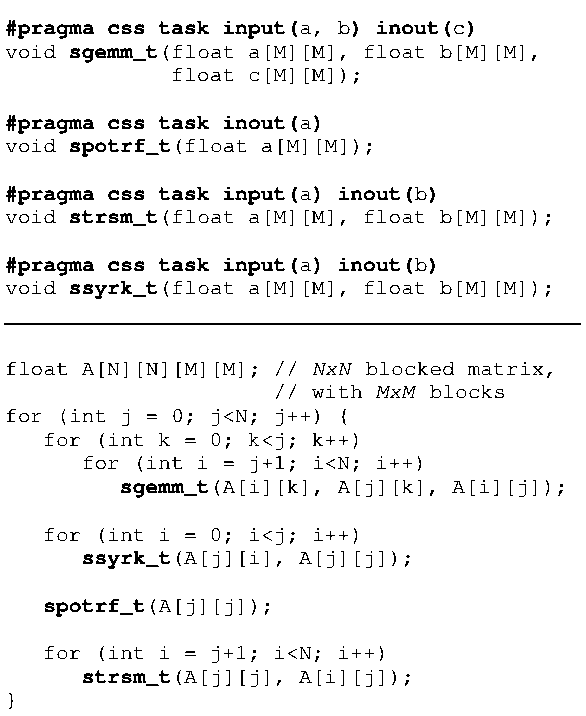

**图 4｜使用 StarSs 编写的分块 Cholesky 分解。**内核声明定义任务生成线程可调用的计算单元；主程序本身仍按顺序编写，运行时仅凭操作数标注建立依赖图，实现自动并行。内核实现来自标准 BLAS 库，对内存块进行操作。

下面同时保留可复制的源代码。

```c
#pragma css task input(a, b) inout(c)
void sgemm_t(float a[M][M], float b[M][M], float c[M][M]);

#pragma css task inout(a)
void spotrf_t(float a[M][M]);

#pragma css task input(a) inout(b)
void strsm_t(float a[M][M], float b[M][M]);

#pragma css task input(a) inout(b)
void ssyrk_t(float a[M][M], float b[M][M]);

float A[N][N][M][M]; // N×N 个分块，每块为 M×M
for (int j = 0; j < N; j++) {
    for (int k = 0; k < j; k++)
        for (int i = j + 1; i < N; i++)
            sgemm_t(A[i][k], A[j][k], A[i][j]);
    for (int i = 0; i < j; i++)
        ssyrk_t(A[j][i], A[j][j]);
    spotrf_t(A[j][j]);
    for (int i = j + 1; i < N; i++)
        strsm_t(A[j][j], A[i][j]);
}
```

运行时，任务生成线程每执行到一个内核调用点，由源到源编译器插入的任务创建代码就会将内核函数指针和全部任务操作数值打包，送入任务流水线。由于任务生成线程无需等待任务执行完毕，随后便可继续运行、生成更多任务（只有任务窗口已满时才会被阻塞）。与此同时，流水线异步解析任务依赖、生成依赖图，并在任务就绪后安排执行。

图 1 就是一个 5×5 矩阵 Cholesky 分解生成的依赖图。它高度不规则的结构，恰恰说明了 StarSs 的表达能力。

StarSs 的顺序代码流程，再加上运行时系统隐式完成的同步和数据传输，共同保证并行执行得到的结果与顺序执行等价。

## 四、流水线前端设计

下面从整体架构入手，依次说明流水线前端的组织方式、运行流程以及各个模块的关键设计。图 5 所示的前端采用模块化的阵列式结构，各模块通过异步点对点协议协同工作。整个前端由四类模块组成。

- **流水线入口（Pipeline Gateway）**：控制任务进入流水线的过程。
- **任务保留站（Task Reservation Station，TRS）**：保存所有在途任务的信息，追踪任务操作数是否就绪。换言之，TRS 实际上承载着任务依赖图。不同 TRS 之间通过消息通信登记数据消费者，并在数据就绪后通知消费者。
- **对象重命名表（Object Renaming Table，ORT）**：将任务操作数映射到相应内存对象的最新版本及其数据生产者。
- **对象版本表（Object Versioning Table，OVT）**：记录仍然有效的操作数版本。每当译码器发现新的数据生产者，就会创建新版本。每个 OVT 都与一个 ORT 一一对应。OVT 的作用类似于物理寄存器文件，但它只保存操作数元数据，不保存数据本身。OVT 还通过操作数重命名消除反依赖和输出依赖。重命名所需的临时操作数缓冲区从操作系统分配的内存空间获取，随后再由外部 DMA 引擎将数据复制回原对象地址。

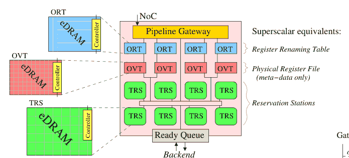

**图 5｜任务超标量前端及各模块的组织方式。**分布式 ORT/OVT 负责重命名与版本管理，TRS 保存任务及依赖关系；就绪队列连接执行后端。图中也标出了它们与传统超标量处理器的对应关系：重命名表、物理寄存器文件（这里只存元数据）和保留站。

每个模块都包含一个控制器，主要占用 1～2 KB 的临时状态存储。另外，ORT、OVT 和 TRS 分别使用 256～768 KB 的 eDRAM 块保存任务及操作数信息。其中只有 ORT 需要进行关联查找；其他模块都可以直接寻址，协议消息中已经包含目标数据在接收模块内的存储位置。

流水线的整体性能在很大程度上取决于配置，包括 ORT、OVT、TRS 的数量及其总存储容量。第六节将评估这些设计取舍。

### 4.1 运行流程

这条流水线的运行过程借鉴了传统乱序处理器。任务被译码后进入 TRS，等待其全部操作数就绪，随后送入就绪队列。某个任务完成时，TRS 遍历该任务的操作数，向它的所有数据消费者发送“数据就绪”消息；同时通知管理相关操作数的 OVT，将对应数据版本的使用计数减一；最后释放该任务元数据占用的空间。

下面进一步说明几个关键步骤。

**第一步：分配任务存储空间。**如图 6 所示，入口首先向某个 TRS 发送分配请求，其中包含任务的操作数数量，后者决定元数据的存储需求。TRS 返回用于保存任务的槽位号，也就是 TRS 内部的存储地址。于是，每个任务都具有一个唯一的二元组 ID：`<TRS编号, 槽位号>`。例如，图 6 中的任务 ID 为 `<1,17>`。在这个 ID 后附上操作数索引，还能生成唯一的操作数 ID；该任务的第一个操作数便表示为 `<1,17,0>`。

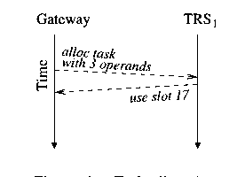

**图 6｜任务分配过程。**入口向 TRS 申请一个可容纳三个操作数的任务槽位，TRS 返回槽位 17。

**第二步：分发操作数并解析依赖。**TRS 分配完成后，入口将操作数发送到对应的 ORT，开始依赖译码。目标 ORT 根据操作数地址的哈希值确定。无需跟踪数据依赖的标量操作数，则直接送入已分配的 TRS。

ORT 的功能与寄存器重命名表相似：将一个内存对象的逻辑地址映射到最近生成该数据的任务操作数 ID，具体处理流程取决于操作数是输入、输出，还是双向访问。

**输出操作数（output）。**如图 7 所示，ORT 首先将基本操作数信息发送给目标 TRS，然后向关联的 OVT 发起版本分配和重命名请求。OVT 为这个操作数创建新数据版本，并分配重命名缓冲区——这相当于传统乱序处理器为架构寄存器的新版本分配一个空闲物理寄存器。重命名完成后，输出操作数便被视为就绪。OVT 向对应 TRS 发出“数据就绪”消息，并携带重命名缓冲区地址；图 7 的示例地址是 7164。

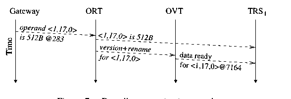

**图 7｜输出操作数的译码流程。**ORT 请求 OVT 创建新版本，OVT 将新缓冲区地址和就绪通知发给 TRS。

**输入操作数（input）。**如图 8 所示，输入必须等到生产其数据的任务完成。ORT 查询最近一个引用该内存对象的 output 或 inout 操作数 ID。图中的数据生产者是 `<2,5,2>`，即 TRS 2 的槽位 5 中那个任务的第 2 号操作数。ORT 把生产者 ID 发给目标 TRS；目标 TRS 随后向存储生产者任务的 TRS 发送消费者登记请求，请求在生产者完成时得到通知。只有生产者真正执行完毕并发来“数据就绪”消息，这个输入操作数才算就绪。

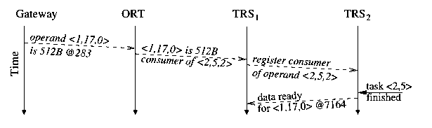

**图 8｜输入操作数的译码流程。**消费者向生产者登记依赖，等待生产者完成后通知。

**双向操作数（inout）。**如图 9 所示，inout 的处理结合了输入和输出两类流程。这里不会进行操作数重命名，因为它属于真正的数据依赖。因此，只有收到**两条**“数据就绪”消息之后，操作数才算准备完毕：第一条表明输入数据已就绪，第二条表明此前的所有读取者都不再使用原来的输出缓冲区。后一条消息由 OVT 在上一版本的所有使用者结束后发出。

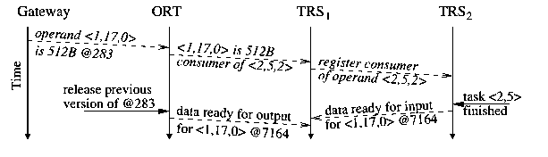

**图 9｜双向操作数的译码流程。**它既需等待输入数据就绪，也需等待前一版本释放。

上面虽然分别介绍了单个操作数的处理流程，但流水线的高性能来自这些流程能够**同时进行**。入口异步地向不同 ORT 推送操作数，各个操作数的译码、任务执行和任务结束处理都可以并行推进。

### 4.2 模块组织与具体实现

#### 4.2.1 流水线入口（Pipeline Gateway）

入口负责为新任务分配 TRS 存储空间，将任务信息分发给各模块，并在流水线已满时阻塞任务生成线程。

新任务首先存放在一个专用的 1 KB 缓冲区中，可容纳 20 多个待处理任务，具体数量取决于每个任务的操作数个数；这个缓冲区占据了入口的大部分面积。

对于每个任务，入口向某个 TRS 发送存储分配请求。由于各 TRS 自行管理存储空间，入口只需维护一个仍有空位的 TRS 队列，并选择队首模块。分配请求还携带任务在入口缓冲区中的地址。TRS 回复时原样带回这个地址，入口便能直接定位等待处理的任务，而不需要关联查找。得益于非阻塞协议，入口在等待某次分配请求得到回复时，仍能继续为新到来的任务申请存储空间。

收到 TRS 的回复后，入口开始向 ORT 分发任务操作数。目标 ORT 根据操作数的基地址确定。但由于内存对象大小各不相同，如果直接用地址的若干位选择 ORT，容易造成负载不均，因此需要对地址做哈希处理。为了尽量降低时延，哈希计算采用流水线实现，并在任务到达入口后立即开始。

#### 4.2.2 任务保留站（TRS）

TRS 保存全部在途任务的元数据，其中包括操作数的数据消费者 ID，因此相当于在存储结构中直接嵌入了任务依赖图。

困难在于：任务依赖图具有不规则结构，而底层采用分布式存储阵列。每个任务作为依赖图中的节点，都有两个可变维度：**任务的操作数数量**以及**每个操作数的数据消费者数量**。为了解决这个问题，我们采用一种图变换，称为**消费者链（consumer chaining）**，以消除其中一个可变维度。

如图 10 所示，消费者被组织成链表。每个操作数只需要保存链表中第一个消费者的 ID，无需维护完整的消费者列表。这样一来，生产者与消费者的界限被有意模糊：每个消费者同时为下一个消费者承担转发通知的作用。例如，图 10 中的 C1 对任务 P 来说是消费者，但对 C2 而言则相当于通知链上的前驱。

真实的数据生产者完成后，把“数据就绪”消息发给消费者链的第一个节点；该节点立即转发给下一个节点，直至整个消费者链收到通知。尽管链式转发会带来额外消息时延，实验中却没有观察到明显的性能损失，因为链通常很短：除两项基准外，其余基准中 95% 的消费者链长度不超过 2；另两项基准也不超过 7。

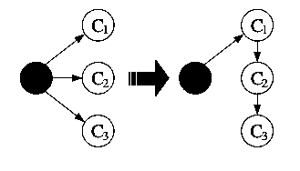

**图 10｜消费者链。**使用同一版本操作数的任务被串接起来，并依次转发数据就绪通知，避免为生产者保存可变长的消费者列表。

TRS 将任务元数据保存在私有 eDRAM 中，使用 128 B 的定长块组成存储数组。为了支持数量可变的操作数，我们借鉴了 UNIX 文件系统 inode 的组织方式，如图 11 所示。每个任务分配一个主块，保存任务全局信息及前 4 个操作数。主块还可指向最多 3 个间接块，每个间接块额外容纳最多 5 个操作数，因此每个任务最多支持 **19 个操作数**。

TRS 收到携带操作数数量的任务分配请求后，根据需求分配相应数量的数据块，并组织任务的存储布局。虽然这种方案会造成内部碎片，但我们测得平均浪费空间仅为已分配内存的约 **20%**。

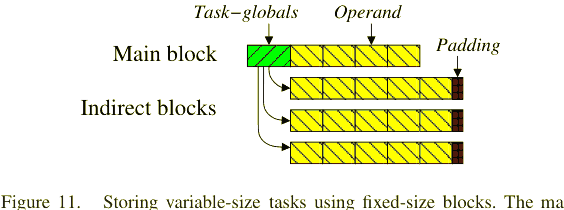

**图 11｜用定长存储块容纳可变长任务。**主块保存任务全局信息和首批操作数，间接块用于保存额外操作数。

空闲块也以链表管理。每个链表节点保存指向另外 63 个空闲块的指针，以及指向下一节点的指针。此外，前 64 个空闲块的地址保存在一个专用 128 B SRAM 缓冲区里。因此，常见的块分配请求直接从 SRAM 缓冲区满足，仅需 **1 个周期**。

值得注意的是，TRS 不需要关联查找。传入消息已经带有任务 ID 二元组，其中包含该任务主块的地址。

#### 4.2.3 对象重命名表（ORT）

ORT 将内存操作数映射到最近一个访问相同内存对象的任务，以便检测对象之间的数据依赖。ORT 不只保存真实的数据生产者，也可以记录任意一个使用者（生产者或消费者），从而支持 TRS 的消费者链机制。

ORT 映射表存放在私有 eDRAM 中，其逻辑结构类似一组以内存对象为条目的 **16 路组相联 Cache**，用对象基地址进行查找。每一组的 Tag 存放在两个 64 B 块中，依次读取，再与真实的操作数地址比较。不过，与普通 Cache 不同，ORT **从不驱逐条目**。如果某组已满而新分配请求还需要在这一组插入条目，ORT 就会暂停入口，直到其中某个条目释放。因此，ORT 实质上是映射到标准 eDRAM 块之上的逻辑 Cache 结构。

如果待译码的操作数是只读的，并且在表中命中（对应 RaR 或 RaW 情况），ORT 就将此前使用者的操作数 ID 发给目标 TRS，流程如图 8、图 9 所示。如果当前操作数会写入数据（output 或 inout），则必须创建新操作数版本，并通知 OVT。如果查找未命中，同样创建新版本。

#### 4.2.4 对象版本表（OVT）

OVT 负责管理操作数所有仍然有效的数据版本。实际上，它通过两种手段处理反依赖与输出依赖：一是对操作数进行重命名；二是把不同的 inout 操作数链接起来，并在前一版本释放后按顺序唤醒后续操作数（即发出“数据就绪”消息）。

每个 OVT 表项对应一个操作数版本，主要保存该版本的使用计数（由 ORT 报告）、指向下一版本的指针，以及指向消费者链首节点的指针。OVT 的内存管理方式与 TRS 类似。

重命名缓冲区的分配采用固定数量的**桶（bucket）**，每个桶负责某个预定的、大小为 2 的整数次幂的数据块。初始化时，操作系统为每个 OVT 指派一块主内存区域，并把它拆成固定大小的块，以驻留在内存中的链表组织。分配时，OVT 从对应桶取出一个缓冲区；如果桶已空，则补入新的内存块。

#### 4.2.5 流水线后端

底层通用 CMP 由执行核心、片上互连和 Cache 层级组成。流水线把可以执行的任务推送至类似 Carbon [13] 的排队系统，不过目前还不支持**任务窃取（task stealing）**。从整个架构的角度看，各处理器核心就像一组执行任务的功能单元。

## 五、实验方法

**系统模型。**我们使用 TaskSim 对任务超标量进行评估。这是一套基于执行轨迹驱动、精确到周期的 CMP 模拟器，并已通过 Cell BE [18] 进行验证。

表 2 汇总了 CMP 模型的主要参数。系统包括 32～256 个顺序执行核心，每个核心有私有 L1 Cache，所有核心共享 L2 Cache。L2 内嵌目录式 MSI 一致性协议。互连采用两级环形拓扑：每 8 个核心组成一个处理器局部环，再由全局环连接各个处理器环、L2 存储体和任务超标量前端。

### 表 2｜模拟系统参数

| 项目 | 配置 |
|---|---|
| 处理器核心 | 32～256 核；顺序执行；双发射；3.2 GHz |
| L1 Cache | 每核私有；64 KB；4 路组相联；3 周期；指令/数据分离 |
| L2 Cache | 共享；32 个 Bank；每 Bank 4 MB；8 路组相联；22 周期 |
| 主存 | 4 个内存控制器，每个控制器 2 个通道；每通道 1 条 800 MHz DDR3 DIMM |
| 互连 | 分段式两级环；16 B/周期；每段支持 4 个并发连接 |
| 任务流水线 | eDRAM 访问延迟 22 周期；另加每个模块 16 周期的处理时间 |

任务超标量前端的 eDRAM 访问延迟为 **22 个周期**。每个流水线模块处理一条协议消息还需增加 **16 个周期**，不包括访问 eDRAM 的开销。若处理消息涉及多个操作数，处理开销随操作数数量成比例增加。

**应用程序。**实验采用表 1 所列的九个基准程序，覆盖多个科学计算领域，并移植到 StarSs 编程模型 [17]。并行化时主要考虑易编程性，尽可能按照算法的自然结构拆分任务，因此每个任务通常只包含十来行以内的代码。

StarSs 源到源编译器将内核调用替换为任务生成代码。插入的代码把内核信息和操作数值打包进一个位于栈上的内存缓冲区，再将其传给软件运行时。与任务超标量流水线连接时，任务生成代码仍沿用相同的内存布局，只需把该缓冲区发送给硬件流水线。

## 六、性能评估

任务超标量流水线能够发掘多少并行性，以及最终取得怎样的性能，很大程度上取决于它实际能够维持多大的**任务窗口**。窗口大小一方面受分配给任务元数据的物理存储容量限制，更重要的是，系统必须让新任务以足够快的速度完成译码并进入窗口，才能赶上处理单元对现有任务的消耗速度。

因此，我们首先研究流水线并行度——即 TRS、ORT 和 OVT 的数量——如何影响任务译码速率；随后考察各模块需要多少存储容量；最后评估整条任务超标量流水线的可扩展性。

### 6.1 任务译码速率

分布式设计能够重叠处理多个任务的依赖译码，从而提升整个前端的吞吐能力。增加 ORT 及其关联 OVT 的数量，可以同时解析更多操作数；增加 TRS 的数量，则能降低单个 TRS 的负载，提高 TRS 间通信的总体处理能力。

图 12 和图 13 展示了流水线并行度对任务译码速率的影响。这里的速率用**相邻两个任务加入任务依赖图之间的平均时间间隔**衡量。图 12 分别观察 Cholesky 和 H264，图 13 则给出全部基准的平均值。两张图一致表明：流水线的并行度越高，任务译码间隔就越短。

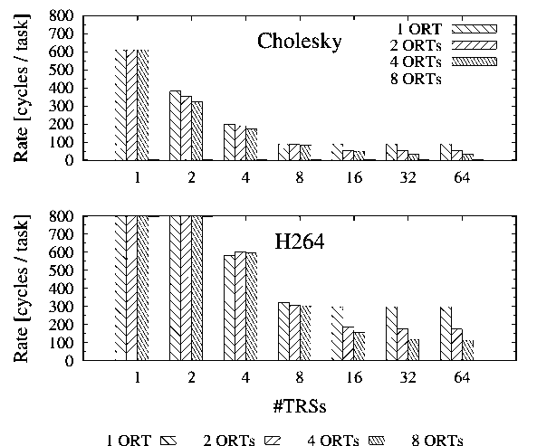

**图 12｜Cholesky（上）和 H264（下）的任务译码间隔。**横轴为 TRS 数量；不同图案对应不同 ORT 数量；纵轴单位为周期/任务。

不过，不同应用的译码性能差别很大。如图 12 所示，当配置为 **4 个 TRS 和 4 个 ORT** 时，Cholesky 的平均译码间隔小于 **185 个周期**，在 3.2 GHz 平台上约为 **58 ns**；同样的配置在 H264 上只能达到约 **300 个周期**。

造成差异的原因是任务操作数数量不同：Cholesky 每个任务最多有 3 个操作数，而 H264 约 **94%** 的任务具有超过 6 个操作数。只有 4 个 ORT 时，H264 往往需要两轮 ORT 处理，而 Cholesky 只需一轮。同时，H264 还会产生更多 TRS 间通信，给 TRS 带来更大压力，并使其向前面的 ORT/OVT 施加反压。增加 TRS 数量可以分摊负载、减轻反压，使 ORT 的并行处理能力真正发挥出来。

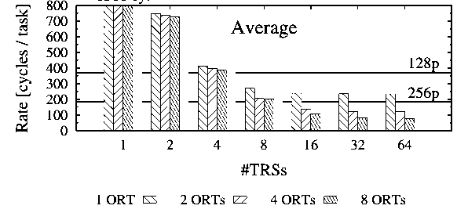

**图 13｜所有基准的平均任务译码间隔。**横线分别表示 128 核和 256 核系统维持处理器利用率所要求的译码间隔上限。

图 13 还把平均译码间隔与第二节推导的 128 核及 256 核目标进行了比较。结果再次证明，增加流水线并行度能够提升译码吞吐率。尤其值得注意的是，**任务依赖图分布在多个 TRS 中**非常重要：如果系统只有一个 TRS，即使增加 ORT 数量，性能也几乎不会改善；反过来，即使只有一个 ORT，增加 TRS 仍然能缩短任务译码间隔。

原因在于：单个 ORT 只是延长了操作数译码时间，并不会完全阻止依赖图上的其他操作同时进行；但如果只有一个 TRS，任务图上的所有操作就都被串行化了。

据此我们确定：使用 **8 个 TRS、2 组 ORT/OVT**，已经足以支持 256 核处理器系统。后续实验均采用这一配置。

### 6.2 任务窗口大小

任务窗口的实际大小取决于组成它的各模块总容量，是一个重要的设计取舍。更大的窗口能发掘更多并行性，但也消耗更多片上存储资源。因此，我们首先在假设窗口无限大的条件下分析性能，再依次研究各流水线阶段容量的影响。

**ORT 与 OVT 的存储容量。**ORT 必须为在途任务访问的每个内存对象保留一个表项，因此其容量以及能容纳的操作数个数，会影响系统可以同时跟踪多少任务。

图 14 展示了增加 ORT 总容量对性能的影响。结果符合预期：随着 ORT 容量增大，任务窗口也随之扩大，能够发掘更多并行性，系统加速比因而提高。然而，当 ORT 容量增大到一定程度后，收益开始趋于平缓：Cholesky 在 **128 KB** 附近趋于饱和，H264 和全部基准的平均结果则在 **512 KB** 附近趋于饱和。

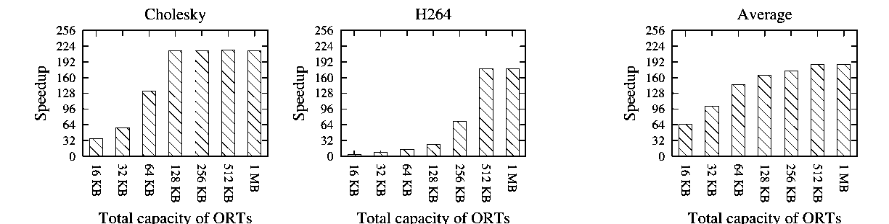

**图 14｜ORT 总容量对性能的影响。**从左至右分别为 Cholesky、H264 和全部基准的平均加速比。

达到这个平衡点时，更大的窗口已经使任务执行吞吐率提高到与新任务进入流水线的速度相当。此后，性能瓶颈不再是任务窗口，而是**任务生成线程本身跟不上任务执行速度**。

这个平衡点因应用而异，取决于可用并行性的多少、依赖图的深度以及每项任务的操作数数量。相比 Cholesky，H264 的 ORT 容量需求更大：一方面它的每项任务有更多操作数，另一方面它包含更远距离的并行性，需要更大的任务窗口才能发现。

综合实验结果，我们选定 **512 KB 的 ORT 总容量**作为较好的设计点。对 OVT 的同类设计空间探索（图中未展示）表明，它也需要相近的存储容量。

**TRS 的存储容量。**TRS 直接组成任务窗口。不过需要强调：TRS 存储空间的大小并不能单独决定任务窗口的有效容量，因为前级模块——尤其是 ORT 和 OVT——可能更早达到容量上限。

图 15 展示了增大 TRS 总容量对加速比的影响。H264 再次成为要求最高的应用：为了发现其远距离并行性，需要约 **6 MB** 的 TRS 存储空间。相比之下，Cholesky 的需求较低，在 **2 MB** 附近便达到性能峰值。对于全部基准的平均结果，性能提升相对平缓：2 MB 已经能够取得大部分潜在收益，但 TRS 容量达到 6 MB 时性能才最终达到峰值。

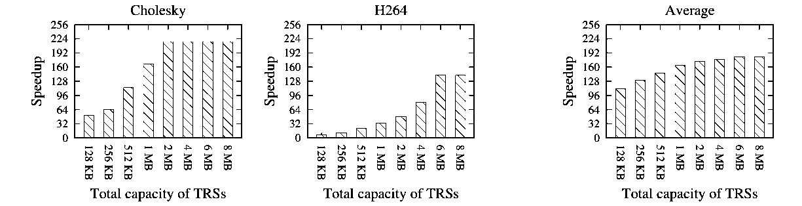

**图 15｜TRS 总容量对性能的影响。**从左至右分别为 Cholesky、H264 和全部基准的平均加速比。

重要的是，**6 MB 的 TRS 容量足以容纳约 12,000～50,000 个任务**。如此庞大的任务窗口，是流水线能够发掘大量并行性的关键。

### 6.3 任务译码速率与任务窗口大小的取舍

任务超标量在任务窗口容量与快速依赖译码之间做出了一种取舍。相比之下，软件运行时可以拥有事实上近乎无限的任务窗口，因此潜在地能够挖掘更多并行性，但它受到依赖译码速度的限制。

图 16 直接比较了任务超标量与 StarSs 软件运行时的可扩展性。除一个基准之外，任务超标量在其余所有基准上都表现出更好的扩展能力；而软件运行时通常无法有效利用超过 **32～64 个处理器**。

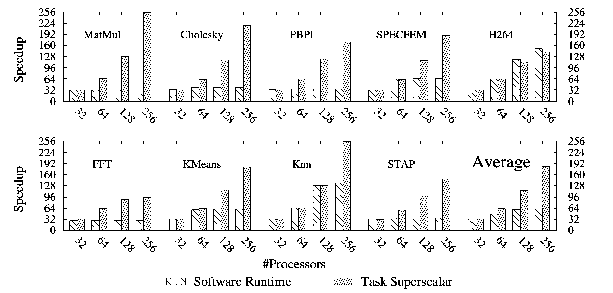

**图 16｜任务超标量与软件运行时的加速比比较。**系统分别使用 32、64、128 和 256 个处理器，纵轴为相对顺序执行的加速比。

软件译码器仅在 Knn 和 H264 两项基准上能够扩展到 **128 个处理器**。这是因为两者的任务执行时间相对较长：在这两项应用中，大约 **95%** 的任务运行时间超过 **100 μs**，因而 128 核对应的译码间隔上限接近 **800 ns**，软件译码器约 **700 ns** 的译码间隔已经足够。

对于 H264，软件近乎无限的任务窗口还发挥了决定性作用。H264 解码器在每一帧内部呈现对角线式波前并行：每个宏块的解码都依赖其西侧、西北侧、北侧和东北侧宏块的解码结果，而且还依赖前一帧中相邻宏块的解码。

每帧包含 **2,000 多个任务**，宏块间的 RaW 依赖链最长可能跨越 **60 帧**。这种异常遥远的并行关系无法被容量有限的硬件任务窗口全部捕获。于是，软件无限窗口的优势得以显现，软件译码器的性能略高于硬件流水线。

不过，要充分发挥软件无限窗口的优势，往往需要针对执行时间很长的任务专门调整应用。与此同时，实际算法通常很难在输入数据仍可放入 L1 Cache 的情况下产生如此长时间的计算。继续延长任务执行时间，通常意味着扩大输入数据集，使其超过 L1 Cache，进而引发访存停顿并降低整体性能。

总的来说，任务超标量流水线提供的**高速依赖译码能力**，加上已经足够大的任务窗口，在绝大多数情况下都优于软件译码器虽近乎无限、但处理速度较慢的任务窗口。

## 七、相关工作

硬件并行规模的快速增长，以及显式并行编程复杂度日益突出，促使研究者将发掘并行性的工作下沉到编译器和硬件中，在指令级并行（ILP）层面完成分析与调度。最典型的例子就是动态调度的乱序处理器：它们维护一个由待执行指令组成的窗口，并按照数据流关系动态调度指令 [16]。

乱序处理器能挖掘多少 ILP，直接取决于其指令窗口大小。但更大的窗口需要更加激进的控制流推测，而且潜在依赖关系的数量与窗口规模之间存在平方量级的增长关系，因此大窗口的设计复杂性很高，也难以被充分利用。

另一类设计，例如 Multiscalar [24]、Trace Processor [21] 和 Stanford Hydra CMP [9]，通过**线程级推测（TLS）**来开发更粗粒度的并行性。这些架构将大的指令窗口拆分为若干较小的、通过推测视为相互独立的线程，并行执行。但一旦对数据依赖或独立性的推测出错，性能收益就会受到影响。

TRIPS [23] 和 WaveScalar [26] 则将静态和动态数据流分析结合起来，以提取更多并行性。不过，它们与早期数据流体系结构 [1,5,15,28] 一样，仍容易受到内存访问和通信延迟的影响 [4]。

随着并行架构发展，传统并行编程模型的繁琐问题也愈发突出，任务式模型由此受到关注。Cilk [3]、OpenMP 3.0、Intel TBB、CUDA 和 OpenCL 的流行表明，任务是一种直观、易理解的编程单元。

任务模型的普及也推动了硬件直接支持任务执行的研究。Carbon [13] 和 ADM [22] 使用硬件任务队列，实现快速任务分发和任务窃取；Hyperprocessor [11] 则通过统一寄存器文件管理全局依赖。

不过，常见的任务式模型仍要求程序员显式管理任务间依赖，而这绝非易事。例如，OpenCL 虽然支持对显式任务图进行动态调度，但任务图本身仍需由程序员手动构建。

正因如此，研究者提出了 Jade [20]、StarSs [2,17]、Intel RapidMind [14]、Sequoia [7]、OoOJava [10] 等任务式数据流编程模型，以及面向特定应用的数据流后端 [25] 和 StreamIt [27] 等流式模型。这些也是本文主要面向的编程模型。它们将任务抽象更进一步：程序员显式标注任务操作数的输入/输出方向，由系统在运行时动态构建任务依赖图。

本文提出的任务超标量，把动态调度乱序处理器的运行机制推广到了任务粒度，提供一个原生的、基于任务的数据流执行引擎。它把乱序处理器挖掘并行性的能力与任务抽象结合起来，为整个 CMP 提供统一的管理层，使处理器核心真正以**功能单元**的方式接受调度。

## 八、结论与未来工作

本文提出了**任务超标量流水线**：一种把乱序超标量处理器的思想抽象到任务粒度的体系结构。借助能够标注任务输入和输出的新一代编程模型，任务超标量支持在运行时分析任务之间的数据依赖，并以乱序方式执行任务。

实验表明，使用 **7 MB 片上 eDRAM**，流水线就能够同时保存数万项在途任务。如此大的任务窗口使系统能够发现远距离并行关系，并对大规模 CMP 进行统一管理。

我们还证明，任务超标量能够高速解析数据依赖，平均每隔 **不到 60 ns** 就可以将一个新任务加入任务窗口。如此高的译码吞吐率，使系统可以支持粒度较细、工作集完全位于 L1 Cache 内的任务，从而减少访存停顿。

最后，我们认为，任务超标量为更高抽象层次上的**异构 CMP 管理**开辟了新的研究方向，同时能够充分利用处理器领域已经积累的乱序执行设计经验。

## 致谢

本研究得到西班牙科学与创新部 Consolider 项目（合同编号 TIN2007-60625）、TERAFLUX 项目（ICT-FP7-249013）、ENCORE 项目（ICT-FP7-248647）、MareIncognito BSC–IBM 合作项目，以及欧洲卓越研究网络 HIPEAC-2（ICT-FP7-217068）的支持。Y. Etsion 获得西班牙科学与创新部 Juan de la Cierva 研究员资助。F. Cabarcas 获得欧盟面向拉丁美洲的高级奖学金计划 AlBan 部分资助，奖学金编号 E05D058240CO。

## 参考文献

*以下参考文献保留原始英文书目信息，便于检索、核对及引用。*

[1] Arvind and R. Nikhil. “Executing a program on the MIT tagged-token dataflow architecture.” *IEEE Transactions on Computers*, 39(3):300–318, Mar. 1990.

[2] P. Bellens, J. Perez, R. Badia, and J. Labarta. “CellSs: a programming model for the Cell BE architecture.” *Supercomputing*, Nov. 2006.

[3] R. D. Blumofe, C. F. Joerg, B. C. Kuszmaul, C. E. Leiserson, K. H. Randall, and Y. Zhou. “Cilk: an efficient multithreaded runtime system.” *Symposium on Principles and Practice of Parallel Programming*, pp. 207–216, 1995.

[4] D. E. Culler, K. E. Schauser, and T. von Eicken. “Two fundamental limits on dataflow multiprocessing.” *International Conference on Parallel Architectures and Compilation Techniques*, pp. 153–164, 1993.

[5] J. B. Dennis and D. Misunas. “A preliminary architecture for a basic data flow processor.” *International Symposium on Computer Architecture*, pp. 126–132, 1974.

[6] Y. Etsion, A. Ramirez, R. M. Badia, E. Ayguadé, J. Labarta, and M. Valero. “Task superscalar: Using processors as functional units.” *Hot Topics in Parallelism*, Jun. 2010.

[7] K. Fatahalian et al. “Sequoia: Programming the memory hierarchy.” *Supercomputing*, 2006.

[8] A. Ghuloum et al. “Future-proof data parallel algorithms and software on Intel multicore architecture.” *Intel Technology Journal*, 11(4), Nov. 2007.

[9] L. Hammond et al. “The Stanford Hydra CMP.” *IEEE Micro*, 20(2):71–84, 2000.

[10] J. Jenista, Y. hun Eom, and B. Demsky. “OoOJava: An out-of-order approach to parallelizing Java.” *Hot Topics in Parallelism*, Jun. 2010.

[11] F. Karim et al. “The Hyperprocessor: A template System-on-Chip architecture for embedded multimedia applications.” *Workshop on Application Specific Processors*, Dec. 2003.

[12] K. Knobe. “Ease of use with concurrent collections (CnC).” *Hot Topics in Parallelism*, Mar. 2009.

[13] S. Kumar, C. J. Hughes, and A. Nguyen. “Carbon: architectural support for fine-grained parallelism on chip multiprocessors.” *International Symposium on Computer Architecture*, pp. 162–173, 2007.

[14] M. McCool. “Data-parallel programming on the Cell BE and the GPU using the RapidMind development platform.” *GSPx Multicore Applications Conference*, Oct. 2006.

[15] G. M. Papadopoulos and K. R. Traub. “Multithreading: a revisionist view of dataflow architectures.” *International Symposium on Computer Architecture*, pp. 342–351, 1991.

[16] Y. N. Patt, W. M. Hwu, and M. Shebanow. “HPS, a new microarchitecture: rationale and introduction.” *International Symposium on Microarchitecture*, pp. 103–108, 1985.

[17] J. Perez, R. Badia, and J. Labarta. “A dependency-aware task-based programming environment for multi-core architectures.” *International Conference on Cluster Computing*, pp. 142–151, Sep. 2008.

[18] A. Rico et al. “Scalable simulation of decoupled accelerator architectures.” Technical Report UPC-DAC-RR-2010-14, Universitat Politècnica de Catalunya, Jun. 2010.

[19] A. Rico, A. Ramirez, and M. Valero. “Available task-level parallelism on the Cell B.E.” *Scientific Programming*, 17(1–2):59–76, 2009.

[20] M. C. Rinard, D. J. Scales, and M. S. Lam. “Jade: A high-level, machine-independent language for parallel programming.” *IEEE Computer*, 26:28–38, 1993.

[21] E. Rotenberg, Q. Jacobson, Y. Sazeides, and J. Smith. “Trace processors.” *International Symposium on Microarchitecture*, p. 138, 1997.

[22] D. Sanchez, R. M. Yoo, and C. Kozyrakis. “Flexible architectural support for fine-grain scheduling.” *International Conference on Architectural Support for Programming Languages and Operating Systems*, pp. 311–322, 2010.

[23] K. Sankaralingam et al. “Distributed microarchitectural protocols in the TRIPS prototype processor.” *International Symposium on Microarchitecture*, pp. 480–491, 2006.

[24] G. S. Sohi, S. E. Breach, and T. N. Vijaykumar. “Multiscalar processors.” *International Symposium on Computer Architecture*, pp. 414–425, 1995.

[25] F. Song, A. YarKhan, and J. Dongarra. “Dynamic task scheduling for linear algebra algorithms on distributed-memory multicore systems.” *Supercomputing*, pp. 1–11, 2009.

[26] S. Swanson, K. Michelson, A. Schwerin, and M. Oskin. “WaveScalar.” *International Symposium on Microarchitecture*, p. 291, 2003.

[27] W. Thies, M. Karczmarek, and S. P. Amarasinghe. “StreamIt: A language for streaming applications.” *International Conference on Compiler Construction*, pp. 179–196, Apr. 2002.

[28] I. Watson and J. Gurd. “A practical data flow computer.” *IEEE Computer*, 15(2):51–57, Feb. 1982.
