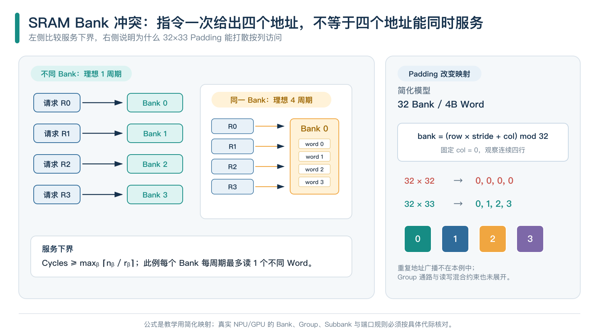
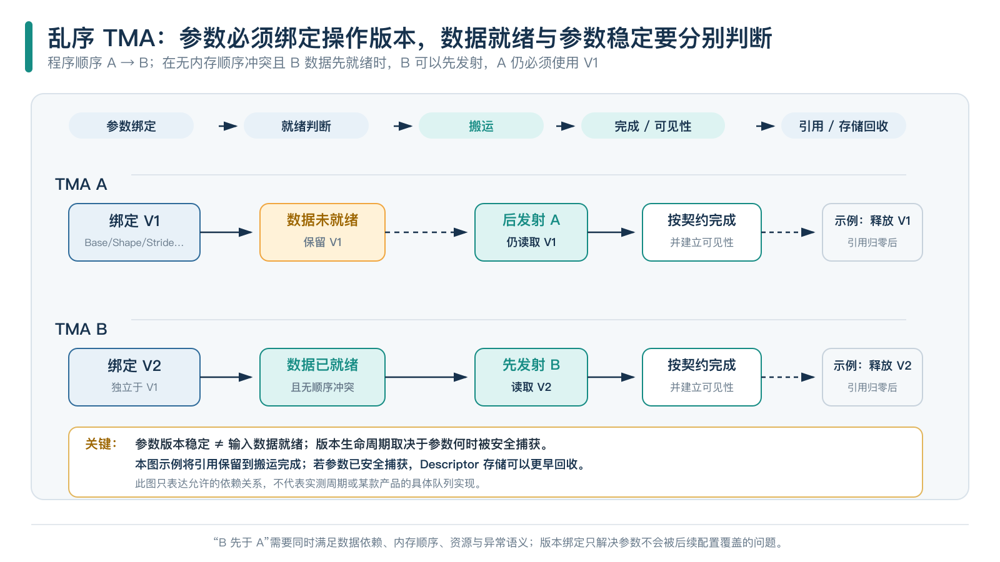

# Gather 为什么有时候这么慢：从访存瓶颈到乱序 TMA

*从 Cache、Bank Conflict 到 ND DMA，再到 SuperScalar NPU 的乱序搬运设计*

## 指令集负责表达愿望，微架构负责兑现承诺

在处理器架构领域，有些指令看起来非常简单，实现起来却能让整个存储系统头疼半天，Gather 就是其中的典型代表。

它的语义很直观：给出一组索引，把对应位置的数据取回来。GPU 可以让不同线程各自执行 Load，CPU 有向量 Gather 指令，NPU 也提供不同层级的索引访存接口。从编程模型来看，这件事情似乎没有什么复杂的：给地址，取数据，完成任务。

但架构师看到 Gather，更关心这些地址究竟落在哪里，有多少请求能够同时发出，Cache 能不能接住，Bank 有没有冲突，数据回来之后又需要经过多少次重排，因为**指令表达的并行度，并不等于存储系统能够兑现的并行度。**

假设一条指令一次 Gather 32 个元素，程序员当然希望硬件一次把 32 个元素全部拿回来。可惜，ISA 负责描述程序想做什么，存储系统负责决定自己有多少能力做这件事。你在指令集里面写了 32 个元素，并不意味着 SRAM 突然多出 32 个读端口，DRAM 也不会因为指令写得比较长，就主动提高自己的服务能力。

这就像架构师在 PPT 里面画了一个 100TB/s 的数据通路，RTL 工程师看完以后，通常先问一句：端口在哪里？

Gather 慢，很多时候是因为有效数据很少，请求却非常分散；也可能因为数据已经搬进了片上 Buffer，结果几个请求恰好挤在同一个 Bank 门口排队。再往后看，即使引入 ND DMA、TMA 这样的专用搬运单元，地址描述符的构造、任务提交和同步也会成为新的开销。

下文从 GPU 的访存合并、CPU 的 Gather 和昇腾 UB 的 Bank Conflict 出发，继续讨论 ND DMA 和 TMA 如何保留地址结构，以及 SuperScalar NPU 如何通过乱序执行 TMA，把搬运和计算组织成一条流水线。

需要说明的是，前半部分关于 GPU、CPU、昇腾的能力与数据，依据对应公开文档和研究范围讨论；后半部分关于 SuperScalar NPU 的乱序 TMA，属于架构设计要求和推导，目前没有实现测量，也没有 PPA 结论。架构师可以大胆设想，但不能把架构草图直接写成硅片成绩单。

*开篇插画：离散请求经过搬运和组织进入计算阵列，用于说明文章主题，不对应某款芯片的实际版图。*

## 一、地址不同，并不意味着访问一定无法合并

假设一个 Warp 有 32 个线程，每个线程分别读取 `x[0]` 到 `x[31]`，每个元素是 4B 的 float，总共读取 128B 数据。虽然 32 个线程访问的是 32 个不同地址，但这些地址恰好连续排列；如果基址适当对齐，硬件只需要几个 32B Sector 就可以覆盖全部数据。这里的关键是：**线程访问地址不同，与存储系统需要处理多少个独立传输单元，并不是一回事。**

即使把线程与元素的对应关系重新排列，只要这一轮访问的地址集合没有改变，底层覆盖的存储区域也不会发生变化。硬件关心的是这一批请求最终覆盖了哪些地址，而不只是 Lane 0 访问了哪里、Lane 1 又访问了哪里。

换一种访问方式，让 32 个线程仍然各读 4B，但分别到相距很远的区域取数据，有效数据仍然只有 128B，存储系统需要处理的地址和传输单元却明显增加了。

这就有点像 32 个人去仓库领零件：如果大家需要的零件都在同一排货架上，仓库一次配送就能解决；如果每个人都要去不同的仓库、不同的楼层拿一个零件，最后拿回来的东西还是那么多，物流成本却完全不一样。

以 NVIDIA 计算能力 CC≥6.0 的 Global Memory 合并访问模型为例，假设 32 个活跃线程，每个线程读取一个不同且自然对齐的 4B 元素，基址 32B 对齐，可以得到下面的结果。这里的 stride 以 4B 元素为单位。

| 同一 Warp 的地址分布 | 32B Sector 数 | Sector 覆盖字节 | 有效数据比例 |
|---|---:|---:|---:|
| 连续，或同一连续集合的任意线程排列 | 4 | 128B | 100% |
| stride 2 | 8 | 256B | 50% |
| stride 4 | 16 | 512B | 25% |
| 每个线程位于不同 Sector | 32 | 1024B | 12.5% |

从 4 个 Sector 增加到 32 个 Sector，覆盖的存储空间扩大了 8 倍，而真正有用的数据仍然只有 128B，这就是典型的访存效率问题。不过，不能据此断言最后一种情况一定慢 8 倍，因为这 8 倍说的是 Sector 覆盖量，并非执行时间；Cache 可能已经持有部分数据，请求可能并行推进，下游也可能进一步合并。Sector、Cache Line、DRAM 物理事务和处理器执行周期属于不同层次，不能用一个数字替代全部。

*图 1：同样读取 128B 有效数据，触及的 32B Sector 可以从 4 个增加到 32 个。覆盖量增加 8 倍，并不意味着运行时间也增加 8 倍。*

Scatter 和 Gather 虽然经常放在一起讨论，语义却可能完全不同。多个线程写入互不重叠的位置，和多个线程对同一个地址执行 Atomic Add，属于两类问题：前者主要考虑写请求的组织与服务，后者还要处理原子更新和竞争。

重复读取一个地址，硬件有机会合并甚至广播；重复写入一个地址，却必须保证最终更新结果正确。把普通 Scatter 和 Atomic Scatter-Add 放在同一张性能表里，却不说明访问是否重叠，最后得出来的结论很可能连比较对象都不一致。

## 二、Cache 的限制，远不止带宽这么简单

Gather 性能不理想时，人们很容易先怀疑 DRAM 带宽不够，但从请求发出到数据返回，中间还隔着多级资源。硬件只能在某个请求边界内形成一批访问，不能把任意时刻出现的地址无限期收集起来，等所有地址齐全后再做一次全局最优排序。

同样一组地址，如果被拆到不同指令、不同批次中，最终形成的请求组织也可能完全不同。因此，讨论 GPU 的 Memory Coalescing，必须说明参与访问的线程、访问宽度，以及硬件能够共同处理的范围。

请求形成以后还要进入 Cache，Cache Line 决定缓存组织的空间范围，Sector 进一步细分实际访问、查询和传输的粒度；Tag 查询能力决定每拍能够检查多少条独立 Cache Line，Data Array 和返回通路决定每拍能够送回多少数据，Miss 跟踪资源则决定有多少未完成请求能够同时在飞。这些资源共同服务一次访问，各自承担的工作却不能互相替代。

例如，把 Cache Line 做得更大，可能对连续访问有好处，但不意味着独立 Tag 查询能力也随之增加。对于每条 Line 只取一个 Word 的 Gather，Line 越大，甚至可能把更多暂时用不到的数据一起带回来。

用一个简单模型来看，假设一批访问需要 Q 次独立 Tag 查询，相关查询通路每拍最多接受 p 次，那么理想情况下至少需要：

`ceil(Q / p)`

个查询服务步。这只是查询阶段的理论下界，实际时间还会受到 Bank、流水线、请求合并和缓存状态的影响。参数 p 直接决定 Tag 查询的并行服务能力；如果硬件每拍只能服务少量独立 Tag 查询，那么即使下游 DRAM 还有大量空闲带宽，请求也可能堵在 Cache 前端。此时继续增加 DRAM 带宽，就像给一条只有一个收费窗口的高速公路扩建后面的车道，车辆依然要在入口排队。

Cache Miss 之后，系统还要保存未完成请求的状态；请求越分散，越可能消耗更多 Miss 跟踪项、下游队列和返回缓冲。当这些资源被占满，前端就可能停止接收新请求，即使 DRAM 还有带宽，也得等前面的请求腾出位置。

MDM 研究在其模拟与 GTX 1080 的研究范围内讨论了 Memory Divergence，包括 L1 Blocking、NoC 和 DRAM 排队。这些机制对理解离散访存很有参考价值，但论文里的资源容量和具体数值属于对应平台，不能直接搬到其他 GPU 或 NPU 上。

更隐蔽的限制来自地址依赖，例如：

`x[index[i]]`

硬件必须读取 `index[i]`，才能知道真正的数据地址。如果索引还没有回来，最终数据请求就无法按原路径发出；此时即使 DRAM 带宽还有余量，增加带宽也无法直接解除这条依赖链。

如果地址跨越很多 Page，TLB 和 Page Walk 也会加入关键路径。

CPU 上还要考虑 Load/Store Port、Fill Buffer、Store Buffer 和写入所有权；GPU 和 NPU 则需要根据各自的数据路径检查对应资源。

Neoverse V2 的手册提供了一个有边界的例子：其 128-bit SVE/SVE2 在所列 L1 命中条件下，连续 LD1* 形式的延迟为 6 cycles，最高吞吐为每周期 3 条；32-bit scaled-offset Gather 则为 10 cycles，每周期 0.5 条，并占用 L 与 V 管线。

这说明在同一个微架构中，连续访问和 Gather 访问也可能有明显差异。但这里的吞吐比不能直接当成任意程序的加速比，更不能拿来给其他处理器做性能排名。

AVX2 有 Gather，没有通用 Scatter；AVX-512 增加相关能力之后，收益仍然依赖具体实现。Spatter 在 Broadwell、Skylake 和 KNL 上观察到了不同的向量化收益，部分 Broadwell 模式甚至变慢。其有效 double 带宽没有计入 Index 流量，也不能直接作为 DRAM 实际带宽。

测试 Gather 时，向量宽度、掩码、索引局部性、缓存状态及微码环境都属于结果的一部分。Nsight Compute 区分 Request、Sector 和 Wavefront，也是在避免把这些不同层次压成一个数字。

**真正需要检查的是从索引生成到数据返回，整条请求链路上究竟哪一个资源先满；DRAM 带宽只是其中一项。**

## 三、数据已经在 Buffer，为什么仍然会排队

Cache 主要面对标签查询、Miss 和外存访问，GPU Shared Memory、昇腾 UB 这类显式管理的片上 Buffer 则受另一组物理条件约束。数据搬进 SRAM 后，访问延迟确实远低于外部存储，但 SRAM 仍然受到 Bank 数量、Bank 映射、读写端口和共享通路的限制，无法提供无限并发。

假设某个 Bank 每拍只能读取一个独立 Word，四个请求同时命中这个 Bank 的四个不同地址，就至少需要四个服务步；指令可以把四次访问写在一起，Bank 却不会因此多出读口，这就是 Bank Conflict。

这里尤其要注意 SRAM 的端口定义。1R1W 表示支持一读一写的组合，不能直接理解成 2R。Bank 数量也不等于可以同时服务的独立读请求数量。架构设计时，如果不把端口和共享资源的关系讲清楚，后面的带宽计算就很容易出现纸面繁荣。

将这个问题抽象成简单模型：假设硬件能够广播重复的 Word，令 Bank b 剩余 n_b 个独立读取，每拍最多服务 r_b 个，且不同 Bank 可以并行、r_b 大于零，则服务步数至少满足：

$$
\text{服务步数}\geq\max_b\left\lceil\frac{n_b}{r_b}\right\rceil
$$

这是给定服务能力下的理想下界，Group 冲突、读写混合、依赖和其他访存单元的竞争都会进一步增加时间。如果同一轮请求全部落到一个单读口 Bank，即使重新排列 Lane 的访问次序，也无法改变这个 Bank 必须逐个服务的事实。

*图 2：左侧展示单读口 Bank 的并行与排队，右侧预示 Padding 方法；32-bank、4B Word 是教学用简化模型，不代表昇腾 UB 的实际组织。*

昇腾的代际差异需要分开讨论。根据 CANN 软件包对应关系，910B 归入这里讨论的 Atlas A2 范围；其官方 2201 资料描述了 192KB UB、48 Banks、16 Groups。950PR/950DT 的 3510 资料则描述 256KB UB、16 Banks、8 Groups，并进一步划分 Subbank；后者还给出 Group 级每拍两读或一读一写等规则。

这两代的组织方式不能互相套用，Group 的服务组合也不能直接推导物理 SRAM 每 Bank 的端口数。

根据已经核实的 3510 Master 预览文档，Commit 为 `dc9f009438d2`，同 Subbank、相同起始地址的相应访问可以合并，而不同起始地址会产生该类冲突；Gather/Scatter 还可能与连续访问或 MTE 竞争。

这个局部规则不能直接推广到 GM，更不能据此得出多个线程向同址 Scatter-Add 没有竞争的结论，因为 GM、UB 和 Atomic 各自有不同的资源与语义边界，接口名称也不能代替路径分析。昇腾 LocalTensor Gather 面向局部存储，文档中每个 Repeat 的处理量不能解释成每周期 GM 吞吐；Triton Ascend v3.6.0 对结构化与非结构化访问采用不同编译路径，950 的混合路径在满足条件时可转成 SIMT Indirect Load/Store。具体 Lowering 可以解释某段代码的成本，却不能据此断言所有 910B GM Gather 都按同一种方式执行。

这里的架构教训很直接：**数据搬进了片上 SRAM，只是解决了外存访问问题，并没有自动解决片上访问的并行度问题。**

## 四、优化必须改变资源的使用方式

优化不能只想着让请求换一个顺序，还要改变数据在存储系统中的分布方式，或者改变硬件每拍能够服务的请求集合。

最直接的方法是 Padding。NVIDIA 在矩阵转置的 Shared Memory 示例中，把原来的 32×32 Tile 改成 32×33：假设 Shared Memory 有 32 个 Bank，原来每行 32 个元素，按列访问时，不同线程可能同时落到同一个 Bank；将行跨度从 32 改成 33 之后，Bank 映射发生变化，原来集中在同一个 Bank 的请求被分散到不同 Bank。数据布局的容量只增加 1/32，也就是 3.125%，却可能显著改善特定访问模式下的 Bank Conflict。

这笔账算得很划算。当然，这个例子有明确的矩阵访问前提。对于任意随机索引，统一补一列并不能保证解决问题。架构优化最怕的就是把一个特定场景下的成功经验，包装成放之四海而皆准的定律。

Swizzle 和 XOR Mapping 采用类似的思路，它们不一定改变数据的逻辑排列，而是改变逻辑地址到物理 Bank 的映射关系，让原来集中在一起的访问分散开来。

例如 NVIDIA TMA 支持的 128B Swizzle，就是针对特定结构化 Tile 的布局优化。公开的 XOR Bank Mapping 研究、排序置换的 DMM 理论，以及 Mergesort 中特定子序列 Gather 的研究，也分别讨论了不同条件下的冲突消除。

一个映射方案可能改善按列读取，却增加另一种访问模式的成本；不存在一种 Swizzle 能够让所有随机访问都自动无冲突。硬件设计没有免费的午餐，换一种地址映射，通常意味着另一种访问模式需要重新评估。

也可以保留数据布局，改变每一拍发出的请求集合，例如先检查一批索引，把落到不同 Bank 的请求组织到同一批次，再在返回端恢复逻辑顺序。这样做有机会提高每批请求的服务并行度，但索引分析要消耗计算资源，请求凑批可能增加等待时间，重排需要额外缓冲，返回数据还要通过逆置换恢复原始逻辑顺序。如果所有请求最终都落到一个单读口 Bank，重排也无法降低该 Bank 的最低服务时间。

这就有点像重新安排排队顺序。把不同窗口能够处理的业务分开，确实可以提高整体效率；但如果 32 个人都要找同一个窗口办理业务，换十次队伍也解决不了窗口数量不足的问题。

对于重复读取，还可以考虑广播或者数据复制。如果多个线程读取同一个 Word，硬件能够广播时，就不必重复访问同一个 Bank；对于只读热点数据，也可以把副本放到不同 Bank，让不同请求选择不同的读取位置。代价是容量和初始化带宽，数据频繁更新时还要维护副本一致性。

另一种更直接的方法是增加真实端口，但这笔账最终会落在 SRAM 面积、功耗和时序上。想让 SRAM 同时服务更多独立请求，通常需要付出实实在在的电路成本。

CPU 上的连续 Load 加 Permute、按照局部性分桶、Blocking，以及提前读取索引，也是在调整同样的资源关系。

SPC5 使用分块连续读取配合 AVX-512 Expand 或 SVE Compact，但当块填充率不足时，性能可能还不如 CSR。Arm 的重复索引直方图示例还需要 HISTCNT 等处理，Scatter 本身并不会自动完成原子归约。

这些例子说明，优化 Gather 不能只看某条指令的吞吐，还要核算数据格式、算法和完整执行过程：减少了多少访存工作，增加了多少预处理，需要多少寄存器，是否引入 Cache 污染，逆置换需要多少时间，数据更新又是否需要额外维护。只有减少的访存成本能够覆盖这些新增开销，优化才真正成立。结构稳定、可以反复利用的访问模式通常更容易获得收益，因为它可以把预处理成本摊销到多次执行中；一次性的任意索引则可能每次都要重新付费。

## 五、CSA 中的 Gather：离散发生在哪一维

DeepSeek CSA 提供了一个更接近实际大模型计算的场景。V4 Model Card 将 CSA 定义为 Compressed Sparse Attention，即先沿序列维度压缩 KV，再应用 DSA；HCA 则是重压缩后执行 Dense Attention 的另一条路径。结合公开实现说明，可以把 CSA 的访存过程抽象成：

索引选择 → 选中压缩 KV 条目 → Attention 消费。

CSA 的离散访问主要发生在 KV 条目的选择上。假设 TopK 选出了若干个 Token 或压缩条目，它们在原始序列中可能相距很远，从序列维度看属于典型的离散访问；但每个 KV 条目内部，沿 Head 维度的数据仍然可以连续排列，因此同一批访问可以表现为块间离散、块内连续。

如果把它简单理解为每个 Lane 随机读取一个 Scalar，就会丢掉最有价值的结构信息。

*图 3：以索引 [1, 6, 3] 示意条目选择，收集后保留索引顺序。实际实现也可以通过融合 Kernel 直接消费数据，不一定需要生成独立的中间 Buffer。*

Gather 不一定要先生成一个完整的中间张量。一种实现方式是先把选中的 KV 条目搬到一个紧凑的 Buffer，然后再执行 Attention；另一种方式是把 Gather 与 Attention 融合，在计算过程中直接读取需要的 KV。

前者的好处是数据路径相对清晰，计算阶段可以直接消费已经整理好的数据；代价是需要额外写入和读取中间结果。

后者省掉了中间 Buffer，但需要把索引、搬运和计算调度组织在同一个 Kernel 中，对寄存器、流水和数据依赖提出更高要求。

架构上需要追问的是，算法产生的连续性能否一直保留到硬件接口。TopK 选出的条目虽然分散，但条目内部的数据仍然有规律；如果硬件只能看到一组完全独立的 Scalar 地址，就浪费了这部分结构信息。

如果能够识别块间离散、块内连续的特征，就有机会采用更合适的搬运粒度。

当然，具体是否采用受限 Tensor Gather、混合路径，或者直接融合到 Attention Kernel 中，还需要看编译器和执行实现。仅凭程序包含 Gather，无法判断整个 Attention 为什么慢。

对于 CSA，TopK 选择、KV 压缩、条目搬运和 Attention 计算，都需要分开核算。真正的性能瓶颈可能出现在任意一个环节。

## 六、仿射 ND DMA：让硬件直接看到地址规律

还有一类访问模式并不需要显式索引表，例如多维 Tensor Load：每个维度的长度和 Stride 都是确定的，至少有一个内层维度连续。逻辑上看，它同样是在不同位置收集数据，但地址并非任意值，而是可以通过简单的仿射表达式计算出来。

$$
addr(i_0,\ldots,i_{D-1}) = base+\sum_{d=0}^{D-1}i_d\times s_d
$$

其中，$L_d$ 表示第 d 维长度，$s_d$ 表示第 d 维的字节步长，$i_d$ 是对应维度的坐标。

如果先把这些地址全部展开成 Index Tile，再交给 Gather，硬件拿到的就是一串已经计算好的地址；如果直接把维度描述符交给硬件，硬件便可以通过递增计数器和进位逻辑产生地址，不需要软件提前生成完整的索引数组，也不需要额外存储和读取这批索引。普通 Gather 把地址交给硬件，ND DMA 则把产生地址的规则交给硬件。

两种接口表达的信息量不同，硬件能够利用的信息也不同。

例如，一个三维紧密正向布局，假设内维长度为 $L_0$，元素大小为 e，内维 Stride 等于 e；如果下一维 Stride 等于 $L_0e$，那么这两个维度在逻辑上就可以折叠成更长的连续段。

更外层同理，硬件因而能够提前知道哪些访问具有连续性，哪些访问可能跨越 Cache Line，哪些片段可以组织成更长的 Burst；真正发出 Burst 时，仍然需要考虑地址对齐、Page Boundary 和接口允许的最大传输长度。

进一步地，如果已知 Bank 映射和 Stride，还可以分析冲突是否具有周期性，将不同的行或块交织发出，再在返回端恢复逻辑顺序。

目的 Buffer 的布局也可以同时规划，例如源端按照连续方式读取，目的端采用 Padding 或 Swizzle 布局，让下一阶段计算按照更合适的方式访问数据。此时 DMA 搬运已经延伸为面向生产者和消费者的联合数据布局设计，前提是源端和目的端都进入整体优化。

如果源端读取很快，目的端写入却集中到少数 Bank，整个搬运仍然会受到限制。反过来，搬入速度很快，下一阶段计算却按照冲突严重的方式读取，同样会抵消前面的优化。

ND DMA 可以减少显式索引生成，也可以让硬件提前看到数据的组织规律，为请求调度、预取、Bank 交织和目的端布局提供更多机会。这些只是可考虑的架构能力，并不意味着某个产品已经实现了整套规划；实现仍然需要地址生成、请求调度、顺序标签、重组缓冲和同步机制。

对于多维 Store，还要额外考虑地址别名、源目的重叠以及写入可见性。不能因为地址表达式简单，就默认可以任意合并和重排。

## 七、GPU 已经有 SIMT，为什么还要 TMA

GPU 的 SIMT 已经能够计算多维地址，NVIDIA 仍然设计 TMA，是因为能够执行搬运，与能够高效组织搬运，是两回事。

在传统 SIMT 模型中，线程可以计算地址、执行 Load/Store，再通过线程协作完成数据搬运。

但这整个过程需要占用 SM 的指令发射资源、地址计算资源和相关寄存器。对于大块、规则、反复出现的 Tensor 搬运，这些工作本身就会占用大量计算线程的资源。

如果把这些工作交给专用搬运单元，计算线程就可以少做一些地址计算和搬运指令，把更多资源留给真正的计算，这也是 TMA 的设计价值。

NVIDIA Hopper Tuning Guide 描述的 Tensor Memory Accelerator，支持由单线程发起较大的 1–5D Tensor 传输，避免数据经过寄存器中转，并减少 SM 侧的搬运指令。

结合异步完成机制，可以让搬运与计算重叠；也可以采用 Warp Specialization，让不同 Warp 分别负责数据准备和计算消费。受支持的 Shared Memory Swizzle 还能把搬运落地布局与后续读取方式结合起来。

这里需要强调一个历史边界：Ampere 的 `cp.async` 已经支持部分绕过寄存器的异步复制能力，异步搬运并不是 TMA 才开始出现的。

TMA 进一步把多维描述、较大粒度的数据传输和相关地址处理组织到专用接口中，解决更高层次的数据搬运组织问题。

通常可以让 TMA 主要承担规则 Strided/Tensor 搬运，让 SIMT 处理更一般的离散 Gather/Scatter。这只是主要适用模式，并不意味着 SIMT 不能处理规则访问，也不意味着 TMA 可以处理任意 Scalar 索引。

TMA 仍然受到维度、Shape、Stride、Alignment 和搬运方向等条件限制。五六维 ND DMA 的通用设想也不能直接写成 NVIDIA TMA 的产品能力，公开常规 Tensor 支持范围是 1–5D。

两者之间还有一个中间地带。PTX 8.6 引入了受限的二维 Tensor Gather4/Scatter4，用于四行数据的汇集或分发，不支持 Interleave，仍然受到 Tile 模式限制，不能据此认为 TMA 已经能够处理任意 Scalar 索引。

其架构支持也需要区分具体形式：Gather4 以 `shared::cta` 为目的要求 `sm_100` 或更高；`shared::cluster` 形式要求 `sm_100a`，PTX 8.8 起另支持 `sm_100f`。Scatter4 则有不同的目标架构要求，不能简单概括成所有 `sm_100+` 都支持。

从架构设计角度看，访问可以分成三个层次：

1. 规则多维 Tensor：地址规律明确，适合描述符驱动的专用搬运。
2. 块间离散、块内连续：适合研究受限 Tensor Gather 或混合路径。
3. 任意元素索引：通常需要更一般的 SIMT Gather/Scatter。

CSA 中的 KV 行选择，就属于需要研究中间一档路径的场景。

这里的目标是让硬件根据地址结构选择合适的搬运方式，无需让 TMA 取代 SIMT。

## 八、参数配置本身，也是一项需要执行的工作

描述符保留了地址结构，也带来了配置成本。一个多维搬运任务需要表达长度、步长、起始位置和 Padding 等信息；如果这些值每次都发生变化，执行端必须在启动之前得到完整状态，地址生成器才能按照正确规则工作。用一个简单模型估算：假设每个维度需要五个参数，三维搬运一共需要十五个参数。

这里的五和十五只是分析接口压力的示意数字，并不对应已经核实的昇腾字段表，Base 是否逐维独立也不能据此确定。

再假设每个参数需要一条配置写入指令，Launch 需要一条指令，那么一次完整配置与启动，就需要十六条指令。

可以考虑把十五条参数写入合并成一条指令，但参数个数、指令数、配置字节和启动延迟需要分开核算：参数个数说明要表达多少项信息，指令数取决于 ISA 如何编码和传递这些信息，配置字节说明实际需要传输多少状态，而启动延迟由参数准备、依赖、传输和硬件接收共同决定。

把十五次写入合并成一次批量加载，可以减少显式指令数，但十五份信息仍然需要经过传输和接收。指令少了，不意味着数据凭空消失，更不意味着参数能够零延迟到达。

架构上可以在编译期构造静态模板，提前准备不变化的参数；也可以批量加载参数，减少软件侧的配置指令；还可以通过 Descriptor Pointer 或 Descriptor ID 引用固定字段，再组合动态 Base 和边界参数，或者对重复使用的描述符建立复用机制，避免每次重新构造全部配置。

但每种方法都需要回答几个问题：描述符放在哪里？谁负责读取？什么时候有效？读取它需要多少带宽和延迟？

尤其对于小块、高频、短生命周期的搬运任务，参数路径甚至可能先于数据路径成为瓶颈。

假设一次配置的十五个参数完全不变，而且可以安全复用 R 次。在单参数单写模型下，总指令数为：

$$
15+R
$$

平均到每次操作：

$$
1+\frac{15}{R}
$$

当 R 越大，参数配置成本就越容易被摊销。

这个算例不表示所有任务都适合复用，动态字段修改、数据准备、同步和版本管理仍然需要成本。尤其当 SuperScalar NPU 允许操作乱序执行时，还必须回答一个比配置指令数量更重要的问题：两个 TMA 操作同时在飞，怎样保证它们各自使用正确的参数版本？

## 九、乱序 TMA：完整参数必须成为操作的一部分

在 SuperScalar NPU 的设计中，如果希望 TMA 成为一种可以乱序执行的操作，就必须满足一个明确要求：每一项 TMA 操作进入可乱序执行状态之前，都要绑定完整、确定的 Base、Stride、Length 和 Padding 参数版本，执行时不能再读取一套可能被后续操作修改的公共配置。

假设程序先后提交两个搬运任务 A 和 B，A 先形成，但它依赖的源数据还没有准备好；B 随后形成，依赖已经满足，可以提前执行。

如果系统只有一套可变的公共 TMA 配置，那么软件在准备 B 时，需要写入新的 Base、Stride 和 Length。这些参数可能覆盖 A 原来使用的配置。

等 A 的数据依赖终于满足，准备执行时，它读取到的已经是 B 的参数，于是 A 本来应该搬运地址 A 的数据，最后却跑去搬运地址 B。

这种错误很有意思。指令本身没有问题，DMA 也没有问题，地址生成器甚至可能工作得非常正常，真正的问题在于两项操作共享了一份生命周期不正确的配置。

参数必须成为操作自身的一部分，不能只存在于随时可能变化的公共寄存器状态中。实现上至少有两种思路：一种是 Snapshot，在一项操作的全部参数准备完成后，将参数复制到该操作自己的记录中形成完整快照，后续软件修改公共配置也不会影响已经提交的任务；另一种是不可变 Descriptor Version，操作不必复制所有参数，而是绑定一个保持有效的不可变描述符版本，执行时再根据版本读取对应内容。

两种方案的物理实现不同，但架构语义必须一致：A 始终使用 A 的参数，B 始终使用 B 的参数。

仅仅保存一个 Descriptor Pointer，却允许其指向的内容被后续操作原地修改，并不能提供这种保证。

*图 4：A 保留 V1 等待数据，B 在依赖和顺序条件允许时先使用 V2 执行。图中只示意版本与依赖关系，不表示实测周期；描述符回收条件也需要与搬运完成分别定义。*

乱序 TMA 的依赖可以拆成两类：参数依赖决定操作究竟要搬什么数据，Base、Stride、Length、Padding 等参数必须完整，并且在操作生命周期内保持稳定；数据与顺序依赖决定操作什么时候允许执行，以及执行结果什么时候能够被消费者看到。这两类依赖不能混在一起。

参数已经准备好，并不意味着数据已经就绪；数据已经就绪，也不意味着目的地址没有与其他在飞操作发生冲突。

例如，两个 TMA 操作可能写入重叠的目的区域。即使它们的参数都已经完整绑定，也不能因此随意交换执行顺序。对于有别名、原子更新和可见性约束的访问，仍然需要正确的依赖管理。

乱序 TMA 因而需要明确的生命周期管理。参数可以分阶段构造，但在绑定之前，不能把半更新的状态当作完整描述符提交。

绑定以后，该操作看到的参数版本必须保持稳定。后续修改应形成新的版本，或者等待旧版本满足合法的回收条件。

生命周期中还需要区分几个容易混淆的完成状态：

1. 参数已经捕获：说明这项操作拥有了确定的配置。
2. 搬运已经发出：说明请求进入了执行路径。
3. 搬运已经完成：说明数据传输达到了相应完成条件。
4. 数据对消费者可见：需要结合内存一致性规则判断。
5. 描述符可以回收：说明没有其他在飞操作仍然需要读取这个版本。

这些时间点不一定重合。例如，参数已经被操作捕获，并不意味着描述符背后的数据已经搬完；搬运完成，也不意味着所有元数据都可以立即释放。

如果这些边界没有在 ISA、硬件和 Runtime 之间统一定义，最终就很容易出现难以复现的竞态问题。

这类问题往往比单纯的性能 Bug 更麻烦：仿真时看起来正常，压力测试偶尔失败，换一个调度顺序又恢复正常，最后大家开始怀疑到底是硬件、编译器还是软件的问题，而根源可能只是生命周期没有定义清楚。

参数版本化不要求每个任务都物理复制一整份描述符，多个操作可以共享同一个不可变静态模板，各自绑定动态字段和版本，在逻辑上形成完整的操作状态，从而保留参数复用的优势，也允许多个版本独立在飞。

落到实现，Snapshot Record 的数量与容量决定能保存多少快照，Descriptor Version 要分配和回收，Task Tag 要关联到操作身份，数据依赖与顺序依赖也要分别跟踪；描述符缓存命中与读取延迟、返回缓冲和目的存储的生命周期，以及资源耗尽时的背压机制，都需要一并纳入设计。

这些结构都会消耗面积、功耗和时序资源：记录容量不足时，前端需要等待；描述符缓存未命中时，启动延迟可能增加；版本管理过于复杂时，也可能引入额外控制开销。

反过来，如果为了维护一套公共配置，强制每次都等上一项 TMA 完成后再修改参数，那么原本能够并行执行的搬运任务就会被串行化。

两种方案都需要算账：增加版本表、快照和依赖跟踪会提高控制复杂度，却不能据此断言性能一定变差；引入乱序能够提供并发机会，也不能直接宣称吞吐一定提高。真正需要比较的是，增加这些控制逻辑能够换回多少有效并发，以及它们能否覆盖原来的参数配置和串行等待成本。

NVIDIA 的异步 TMA 与这里讨论的乱序执行 TMA 也需要区分。异步意味着发起者可以在搬运进行时继续执行其他工作；乱序设计进一步要求系统能够管理多个在飞操作的就绪状态、执行次序、参数版本和数据依赖。

公开产品具备异步搬运能力，并不能直接证明另一种架构已经具备相同的乱序语义。

## 十、回到 Gather：把数据路径和控制路径放在一起

回到最初的问题，Gather 有时候很慢，是因为从 GPU 的 Global Memory、CPU 的 Cache 到昇腾 UB，都存在同一个矛盾：数据的逻辑组织方式与硬件物理服务能力之间有多大差距。

有些 Gather 容易优化，因为地址集合中存在足够长的连续段，布局可以调整，重复读取可以合并，或者索引模式能够反复利用，使预处理和归位成本得到摊销。

还有一些 Gather 持续很慢，因为请求集中在少数服务资源，索引依赖难以提前解除，数据复制受容量和更新成本限制，而数据本身又缺少可利用的结构。

完整分析要同时覆盖三个层次。数据路径要说明算法和接口表达的是任意 Scalar 索引，还是块间离散、块内连续，以及能否通过 Padding、Swizzle、Blocking 或数据复制改善实际访问分布；控制路径要说明硬件如何得到完整、确定的搬运参数，能否通过 ND DMA 保留多维地址规律、通过 Descriptor 复用减少配置成本，并在多个任务同时在飞时保证每项操作使用正确的参数版本；执行调度则要处理任务间数据依赖、提前执行、计算重叠、返回数据可见性和资源不足时的背压。

只优化源端访存，目的 Buffer 仍然可能发生 Bank Conflict；即使搬运指令已经减少，描述符生成也可能非常昂贵；即使引入了乱序调度，版本和依赖管理又可能成为新的限制。

因此，评价 Gather、ND DMA 或 TMA，不能只看指令数量和理论带宽，而应该把索引准备、配置构造、数据传输、重排归位和同步全部放回同一条执行时间线，观察哪些成本可以重叠，哪些成本决定启动间隔，哪些最终决定整个任务的完成时间。

本文没有运行跨平台基准，引用的手册数据、历史测量和模型例子也不构成 GPU、910B、950 与 CPU 的绝对性能排名。

对于 SuperScalar NPU，一个可研究的方向是设计能够保留数据结构、及时交付完整参数，并让多个搬运任务安全在飞的接口，使 TMA 从由软件发起、硬件执行的 DMA 命令，扩展为可以进入处理器调度体系、具有明确操作身份、参数版本和依赖语义的架构操作。这样，搬运便有机会像计算指令一样参与乱序调度，同时也会引入额外的控制结构。架构师需要把增加的面积、功耗和控制延迟，与减少的参数配置成本、等待时间和数据搬运开销放在同一张账本上。

一条指令能够表达多少元素，与硬件一拍能够服务多少请求，始终是两笔账。把地址结构保留下来，把参数和依赖交代清楚，再让多个独立操作有机会并行执行，才有可能真正改善 Gather 的效率。

好的架构设计不追求让一条指令看起来做得更多，而要让整个系统少做无效工作。给处理器增加控制逻辑，有机会减少后端存储系统的额外工作；这笔投资是否划算，最终要看整颗芯片的账，不能只看某一个模块的面积。

## 参考资料

本文参考以下公开资料。各资料的适用范围、架构版本和实验条件应以对应文档为准。

1. [CUDA Best Practices Guide — Coalesced Access to Global Memory](https://docs.nvidia.com/cuda/cuda-c-best-practices-guide/index.html#coalesced-access-to-global-memory)
2. [MDM: The GPU Memory Divergence Model](https://microarch.org/micro53/papers/738300b009.pdf)
3. [Arm Neoverse V2 Software Optimization Guide](https://documentation-service.arm.com/static/668bc0a369e89f01e39c4668)
4. [Spatter: A Tool for Evaluating Gather / Scatter Performance](https://arxiv.org/html/1811.03743v5)
5. [Nsight Compute Profiling Guide](https://docs.nvidia.com/nsight-compute/ProfilingGuide/index.html#quantities)
6. [昇腾 2201 UB Bank Conflict 说明](https://asc.gitcode.com/guide/operator_practice/simd_operator_optimization/memory_access/avoid_ub_bank_conflict/avoid_bank_conflict_npu_arch_2201.html)
7. [昇腾 3510 UB Bank Conflict 说明](https://asc.gitcode.com/guide/operator_practice/simd_operator_optimization/memory_access/avoid_ub_bank_conflict/avoid_bank_conflict_npu_arch_3510.html)
8. [Triton Ascend v3.6.0 架构说明](https://triton-ascend.readthedocs.io/zh-cn/v3.6.0/architecture_design_and_core_features.html)
9. [CUDA Shared Memory Matrix Multiplication 示例](https://docs.nvidia.com/cuda/cuda-c-best-practices-guide/index.html#shared-memory-in-matrix-multiplication-c-aat)
10. [CUDA Shared Memory Bank Swizzling](https://docs.nvidia.com/cuda/cuda-programming-guide/04-special-topics/async-copies.html#shared-memory-bank-swizzling)
11. [SPC5](https://arxiv.org/html/2307.14774v1)
12. [Arm SVE Programming Examples](https://documentation-service.arm.com/static/6659c722876c8d213b7870d3)
13. [DeepSeek V4 Model Card](https://fe-static.deepseek.com/chat/transparency/deepseek-V4-model-card-EN.pdf)
14. [TensorRT-LLM: DeepSeek V4 on NVIDIA Blackwell](https://nvidia.github.io/TensorRT-LLM/blogs/tech_blog/blog26_DeepSeek_V4_on_NVIDIA_Blackwell_Model_Specific_and_Agentic_Workload_Optimizations_in_TensorRT-LLM.html)
15. [NVIDIA Hopper Tuning Guide](https://docs.nvidia.com/cuda/hopper-tuning-guide/index.html)
16. [CUDA Asynchronous Copy](https://docs.nvidia.com/cuda/archive/13.2.1/cuda-programming-guide/04-special-topics/async-copies.html)
17. [PTX ISA — Data Movement and Conversion Instructions](https://docs.nvidia.com/cuda/parallel-thread-execution/index.html#data-movement-and-conversion-instructions-cp-async-bulk-tensor)
18. [CANN 软件安装与版本对应关系](https://www.hiascend.com/document/detail/zh/CANNCommunityEdition/910/softwareinst/instg/instg_0056.html)
19. [昇腾 Gather API](https://asc.gitcode.com/api/SIMD-API/basic_api/memory_vector_compute/scatter_gather/Gather.html)
20. [Configurable XOR Hash Functions for Banked Scratchpad Memories](https://research.tue.nl/en/publications/configurable-xor-hash-functions-for-banked-scratchpad-memories-in/)
21. [DMM Theory](https://arxiv.org/abs/1507.01391)
22. [Mergesort Gather Research](https://algoparc.ics.hawaii.edu/pubs/p25-spaa.pdf)

说明：3510 UB 相关规则依据已核实的 asc-devkit Master 预览资料，Commit `dc9f009438d2`。具体编译路径和硬件行为均应以相应版本文档为准。
